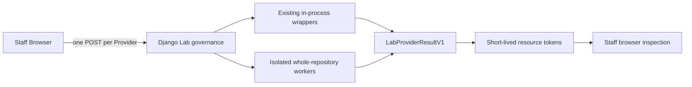

# AnimeImages

AnimeImages 是一个多平台媒体解析、预览和浏览器下载工作台。平台能力按照经过真实样本验证的固定 Provider 路线执行，而不是在每次请求中遍历所有解析器并猜测最优结果。

AnimeImages 负责：

- 识别用户输入与目标内容；
- 调用固定平台路线中的 Provider；
- 校验媒体候选、来源身份和内容关系；
- 将 Provider 结果归一化为统一资源；
- 展示预览并签发受约束的下载描述；
- 维护权限、限流、超时、日志和运行边界。

AnimeImages 不是：

- 任意 URL 的服务器代理；
- 自动抓取所有网页的通用爬虫；
- 自动调用全部 Provider 的 Broker；
- 自动评分和改写正式路线的 Provider Planner；
- 默认持久化用户解析历史的媒体仓库。

## 当前状态

> **Development main**：`457139b98d67d6e5f79b099f9a4e91d60a26904f`<br>
> **Last recorded Production Runtime**：`38992e955f2f268c2a6d4ecd81d900feba83f048`

Development main 已包含 PR #74、#75 和 #76 的应用能力；本次文档任务没有访问生产服务器，也没有证据表明这些 PR 已部署。合并进入 `main` 不等于已部署，详细状态见[当前版本状态](docs/current-version-status.md)。

当前关系：

```text
development main
    newer application capabilities and documentation
                 |
                 | separate, explicitly authorized release task
                 v
recorded production runtime
```

## 核心能力

- 单条解析：小红书、抖音、哔哩哔哩及受控的可选长尾平台。
- 批量解析：逐条、有界地处理多链接；单条失败或超时不阻塞后续结果。
- 媒体预览：预览资源与原始下载资源分离，图片预览经过受限校验。
- 浏览器下载：普通媒体尽量保持 Provider/CDN 到用户浏览器的数据路径。
- 图片归档：浏览器生成有序图片 ZIP，不以预览图替代原始资源。
- Staff Rich Media：Active Staff 的小红书单条结果支持 Live Photo 一次播放及 still + motion 归档。
- Provider 运维：后台运行开关、健康检查、审计和观测入口。
- Provider Lab：Staff-only 的上游对比工具，不参与正式用户路线。

主要页面：

| 页面 | 路径 | 用途 |
| --- | --- | --- |
| 通用解析 | `/` | 单条媒体解析与下载 |
| 小红书 | `/xhs/` | 小红书专用入口 |
| 抖音 | `/tiktok/` | 抖音专用入口 |
| 哔哩哔哩 | `/bilibili/` | Bilibili 视频入口 |
| 批量解析 | `/batch/` | 多链接逐条解析 |
| 图库 | `/library/` | 本地图库浏览 |
| Django 后台 | `/admin/` | Staff 运维入口 |
| Provider Lab | `/admin/provider-lab/` | Staff-only 上游对比实验室 |

具体页面是否可见还受登录身份、Runtime Setting 和能力开关约束。

## 平台能力矩阵

表中的“开发 main”描述仓库能力，不代表已记录生产 Runtime 已经具备。

| 平台 | 单条视频 | 单条图片/图集 | Staff Rich Media | Batch | 固定路线 / 可选 Runtime | 开发 main | 已记录生产 |
| --- | --- | --- | --- | --- | --- | --- | --- |
| 小红书 | 普通视频；可选 Ultra | 有序原图图集 | 单条 Live Photo 播放与归档 | 静态图片和普通视频；无 Live Photo motion | Native 身份；视频可用 TianTian；图片可用 ParseHub XHS Runtime | PR #74/#75 已合并 | 未记录部署这些变化 |
| 抖音 | Native 基线；可选 Ultra | 非主要能力 | 无 | 支持，Provider 顺序独立于单条 | Ultra 优先 TianTian，保留 KuKuTool 与 Native fallback | 支持 | PR #65 为最后记录 Runtime |
| 哔哩哔哩 | Native video-only | 不提供 Dynamic/Opus 图集 | 无 | 受现有 Batch 平台能力约束 | 官方 View/PlayURL；优先完整 DURL | 支持 | 不因 Provider Lab 审计改变 |
| YouTube / 通用视频 | 可选 yt-dlp；必要时服务器生成 merge 输出 | 不适用 | 无 | 受 Generic 能力和平台 gate 约束 | 可选通用 Provider，默认不是全部公开 | 条件支持 | 以已记录 Runtime 配置为准 |
| 通用图片 / gallery | 不适用 | 可选 gallery-dl 等受控 Provider | 无 | 受 Generic 能力和平台 gate 约束 | 可选长尾能力，不是稳定全站支持声明 | 条件支持 | 以已记录 Runtime 配置为准 |

长尾平台属于 **optional generic provider capability**。一个工具声称支持某网站，不等于 AnimeImages 已完成该平台的产品、安全和下载验收。

## 小红书固定路线

### 普通视频

Native 负责确认 exact note identity，并提供标题、作者、封面和文件名等内容语义。

```text
普通模式
  Native video

Ultra 开启
  Native identity and metadata
        |
        v
  TianTianJieXi high-quality video
        |
        +-- unavailable/invalid --> Native video fallback
```

TianTianJieXi（天天解析，后文简称 TianTian）只参与普通视频 Ultra 路线。图片和 Live Photo 路线不会调用 TianTian。

### 图片与图集

Native 是目标笔记身份、item 数量和源顺序的权威来源；ParseHub XHS Runtime 只供应经过准入的 raw original image candidate。

```text
Native exact note identity and item order
                    |
                    v
        ParseHub raw original candidate
                    |
                    +-- absent/rejected --> Native exact same-item fallback
```

预览 URL 与原始下载资源分离。原图下载保留经过文件头验证的以下格式：

- JPEG
- PNG
- GIF
- WebP
- AVIF
- HEIC

ParseHub XHS Runtime 被禁用、不可用或候选不通过验证时，路线 fail closed 到同一 item 的 Native 资源；它不会打乱 Native 顺序，也不会把无关图片补入当前笔记。

### Live Photo 边界

| 入口 | 展示 | Motion | 归档 |
| --- | --- | --- | --- |
| Anonymous Single | 普通 flat images | 不暴露 | 普通图片下载 |
| Active Staff Single | Live Photo 标记与一次播放 | 点击后加载，ended 自动恢复 still | original still + motion MP4 浏览器归档 |
| Batch | flat static images | 不暴露 | 普通静态图片归档 |

Live Photo 播放为 one-shot：每次点击播放一次，自然结束后恢复静态图，可再次点击重播。Live Photo Archive 保存 original still 与 motion MP4；它不承诺自动导入 iOS Photos，也不等同于 Apple 原生 Live Photo 容器导入流程。

## 抖音固定路线

普通解析使用 Native baseline。Ultra 路线由固定 Provider Strategy 调度：

```text
Single Ultra
  TianTian preferred
      -> KuKuTool fallback / race reserve
      -> Native fallback

Batch Ultra
  TianTian
      -> Native fallback
```

Single 与 Batch 的 Provider 顺序并不完全相同，不能用其中一个页面推断另一个页面。短链、标准视频链接、用户页 modal 链接和分享文本先经过 Source Lifecycle 归一，再进入同一内容身份与受控缓存边界。

最后记录的生产 Runtime 来自 PR #65，其核心是受审查的抖音最终 CDN redirect policy 与明确的终止下载错误。此处不会把更新的小红书开发能力误写成抖音生产状态。

## 哔哩哔哩固定路线

当前正式范围是 **Native video-only**：

- 接受 BV、AV 和 `b23.tv` 链接；
- 支持 `p=` 分 P；
- 解析标题、作者和封面；
- 使用官方 View/PlayURL 数据；
- 优先完整 DURL 媒体。

Provider Lab 对三个真实视频样本的对比显示，AnimeImages Native、TianTian、videodl 和官方 DURL 的底层媒体字节一致，未证明 TianTian 或 videodl 带来质量增量。ParseHub 观察到额外格式元数据，但未形成可交付的额外媒体候选。因此正式路线保持 Native。

当前延期范围：

- Dynamic 与 Opus；
- Live Photo；
- Cookie / member-only 质量；
- DASH 音视频 merge 升级。

yt-dlp 在首次 Bilibili Lab 对比中返回 Provider process failure。该已知 Provider-specific 限制被独立呈现，不影响其它 Provider，也不构成修改正式 Bilibili 路线的理由。

## 下载数据路径

普通 Provider 视频的目标路径：

```text
Provider / CDN
      -> Browser Service Worker
      -> Browser Download Manager
      -> Disk
```

普通图片与静态图集归档：

```text
Image CDN
      -> Browser image/archive implementation
      -> Disk
```

Staff Live Photo 归档：

```text
Still CDN + Motion CDN
      -> Browser archive
      -> Disk
```

AnimeImages 在这些路径中承担控制面、校验和 Manifest/descriptor authority。普通媒体不使用 Server Relay 作为默认或自动 fallback；浏览器失败会明确终止并允许重试或重新解析。服务器生成的输出，例如确实需要音视频 merge 或显式生成新文件的任务，仍可使用独立服务端流程，因此“普通媒体 zero relay”不等于项目永远不传输任何媒体字节。

## Provider Lab

Provider Lab 是 Django monolith 内的 Staff-only 对比模块。它不会自动选择赢家，也不会改变任何正式平台路线。



固定 Registry 包含：

- `animeimages_current`
- `parsehub_repo`
- `videodl_repo`
- `yt_dlp_existing`
- `tiantian_existing`

浏览器最多并发 3 个 Provider；每个 Provider 单独 POST，服务端不自动 fan out。刷新页面会清除结果，Lab 不持久化解析历史，也不进行完整媒体 Server Relay。

默认状态：

```text
UPSTREAM_PROVIDER_LAB_ENABLED=False
VIDEODL_PROVIDER_LAB_ENABLED=False
```

ParseHub Provider Lab Worker 与正式 XHS ParseHub Runtime 是两套用途和开关不同的运行路径。videodl 使用 PolyForm Noncommercial 1.0.0，仅限 noncommercial local Staff Lab，不是生产候选。完整操作说明见 [Provider Lab 指南](docs/provider-lab.md)。

## 本地快速启动

要求：Python 3、Node.js，以及项目依赖所需的系统工具。普通开发启动不要求安装 ParseHub 或 videodl 的 Provider Lab Runtime。

```bash
git clone <repository>
cd AnimeImages
python3 -m venv .venv
source .venv/bin/activate
python -m pip install --upgrade pip
python -m pip install -r requirements.txt
cp .env.example.local .env
python manage.py check
python manage.py migrate
python manage.py runserver
```

默认地址是 `http://127.0.0.1:8000/`。Windows 和更完整的日常开发流程见[开发指南](docs/development.md)。

常用验证：

```bash
python manage.py check
python manage.py makemigrations --check --dry-run
python manage.py test xhs_download --noinput
node --test tests_js/*.test.js
node --check static/js/*.js
git diff --check
```

## 可选 Provider Runtime

正式 Provider capability、Runtime exposure、platform allowlist 和 rollout 是分离的 gate，详见 [Provider Runtime Gates](docs/provider-runtime-gates.md)。

可选运行时包括：

- TianTian 与 KuKuTool 的平台固定路线能力；
- yt-dlp / gallery-dl 长尾解析；
- YouTube 服务端 merge 输出；
- ParseHub XHS Runtime；
- Staff-only Provider Lab 的 ParseHub / videodl 隔离环境。

不要把 Provider-specific venv 安装进应用 `.venv`。Provider Lab 的初始化命令和 exact pins 见[稳定指南](docs/provider-lab.md)。

## 后台入口

常用 Staff 运维页面：

- `/admin/provider-settings/`：正式 Provider Runtime exposure；
- `/admin/provider-health-tests/`：Provider 健康检查；
- `/admin/provider-audit-logs/`：Provider 设置审计；
- `/admin/ops-dashboard/`：运行观测；
- `/admin/batch-runtime/`：Batch 运行参数；
- `/admin/provider-lab/`：独立的 Provider 对比实验室。

Provider Lab 不能通过 Admin Provider Settings 开放给匿名用户；它没有 `public_gray` 或 `public` 发布模式。

## 开发与生产状态

- `main` 是开发仓库的 canonical branch。
- Production checkout 不是开发基线。
- Development main 当前包含尚未记录部署的 PR #74、#75 和 #76。
- Last recorded Production Runtime 是 `38992e955f2f268c2a6d4ecd81d900feba83f048`。
- 本次文档任务没有访问、修改、重启或部署生产。
- Production rollout 必须作为单独、明确授权的任务执行。

PR #62 `feat/external-tool-progress-materials-v1` 仍为 OPEN / Draft / deferred，未合并，不属于当前 main 能力。

## 安全边界

- Provider 和媒体目标使用固定 scheme/host/final-host 准入，不接受任意代理地址。
- Public、Staff、Batch 和 Provider Health 的能力边界分别验证。
- Provider manifest、resource token 和下载 descriptor 均短期、受范围约束。
- 初始 HTML 和脱敏 JSON 不应包含 Provider 原始媒体 URL、Cookie 或凭据。
- 外部工具在有界子进程、临时 HOME/CWD 和限制输出中运行。
- Provider Lab 只返回脱敏归一结果，资源检查使用短期 Staff-bound token。
- 解析结果默认不持久化；用户反馈与历史 submissions 模型是不同的数据边界。
- 生产依赖、密钥、Redis 和 Runtime Settings 必须由部署环境提供。

## 已知限制

| 类型 | 限制 |
| --- | --- |
| Code | Bilibili 正式路线仍为 Native video-only，Dynamic/Opus 和 DASH merge 未产品化 |
| Code | 需要特殊 Header/Cookie 的资源可能无法由浏览器直接检查或下载 |
| Product | Anonymous 与 Batch 不提供 XHS Live Photo motion、播放或 pair archive |
| Product | Live Photo Archive 不自动导入 iOS Photos |
| Product | Provider Lab 不自动选择 Provider，resource inspection 也不是完整文件证明 |
| Product | Provider Lab 刷新后结果消失，且只允许 Staff 使用 |
| License | videodl 仅限 noncommercial local Staff Lab，不能进入公开或生产路线 |
| Provider | yt-dlp 在首次 Bilibili Lab 对比中执行失败，当前记录为非阻塞限制 |
| Deployment | Development main 新于 recorded Production Runtime |
| Deployment | Provider Lab 及 PR #74/#75/#76 未被本任务记录为已部署 |

## 文档索引

### Getting Started

- [开发指南](docs/development.md)
- [仓库治理](docs/repository-governance.md)

### Current Status

- [当前版本状态](docs/current-version-status.md)
- [Codex Handoff](docs/codex-handoff.md)
- [生产行为基线](docs/production-behavior-baseline-v1.md)

### Architecture

- [当前架构](docs/architecture.md)
- [下载路由](docs/download-routing-engine.md)
- [Provider 资源生命周期](docs/provider-resource-lifecycle.md)

### Provider Operations

- [Provider Runtime Gates](docs/provider-runtime-gates.md)
- [Provider Health Tests](docs/admin-provider-health-tests.md)
- [后台观测](docs/admin-observability.md)
- [TianTian API](docs/tiantianjiexi-api.md)

### Provider Lab

- [Provider Lab 稳定使用指南](docs/provider-lab.md)
- [Provider Lab 研究与阶段性证据](docs/research/provider_lab/01_UPSTREAM_PROVIDER_LAB_V1.md)

### Deployment

- [生产部署检查清单](docs/production-deploy-checklist.md)
- [Release Management](docs/release-management.md)
- [生产基础设施基线](docs/production-infrastructure-baseline-v1.md)

### Research / Historical Evidence

- [ParseHub 研究索引](docs/research/parsehub/01_UPSTREAM_BASELINE.md)
- [XHS Live Photo 实证](docs/research/parsehub/15_XHS_LIVEPHOTO_REAL_PAYLOAD_EVIDENCE_V1.md)
- [Production main reconciliation](docs/research/production-main-reconciliation-v1.md)
- [历史下载传输考古](docs/research/v1-download-transport-archaeology.md)

稳定使用说明以 README 和非 `research` 文档为入口；`docs/research/` 保存历史证据、阶段性结论和尚未产品化的候选设计。
