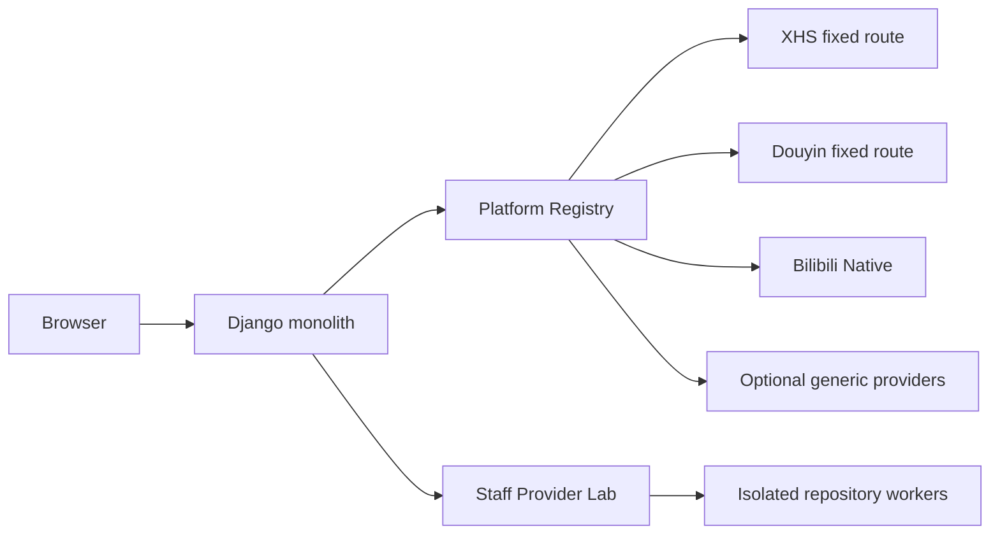
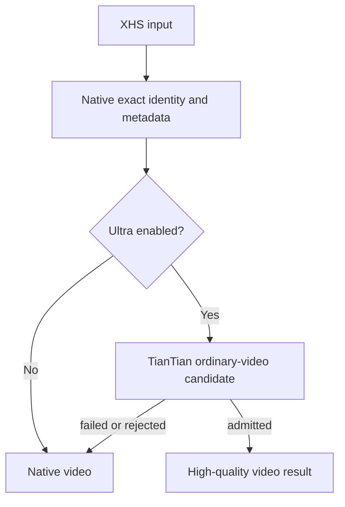
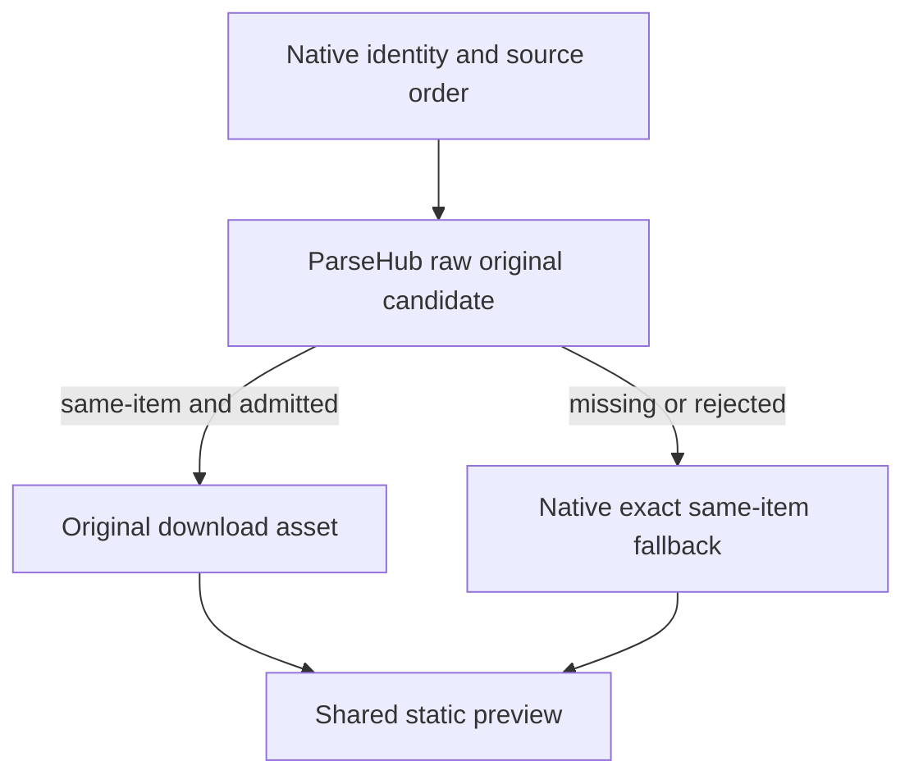
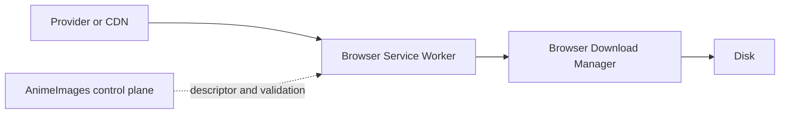
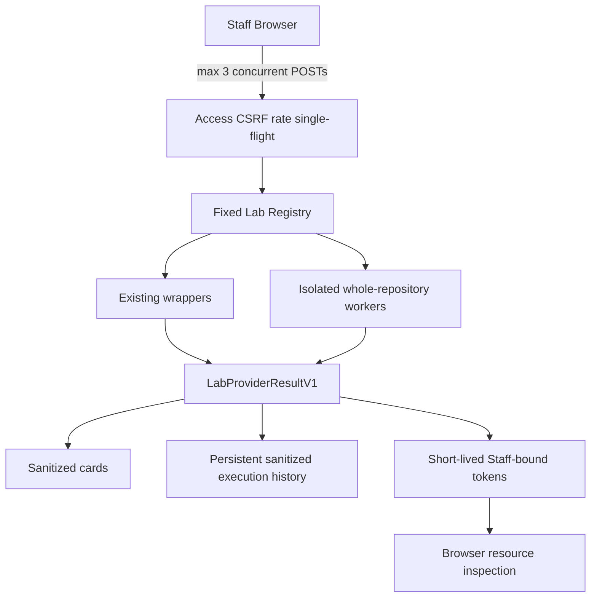

# Architecture

本文按应用快照 `c2b8ac51cfb87d4c030d321bf763080708db9593` 核对稳定结构。当前 main 须重新 fetch；生产及历史证据统一见 [当前版本状态](current-version-status.md)，不从合并推断部署。

## 系统定位

DokiTool（仓库及内部名称 AnimeImages）是一个 Django monolith。正式请求在成熟平台路线或受控通用路线中完成识别、Provider 调用、候选准入、结果归一化、预览和下载授权。

Provider Lab 也是 monolith 内的模块，可以启动隔离的 external repository Runtime、保留脱敏执行历史并提供人工路线编辑入口；比较本身不自动修改正式路线。它不是微服务或自动 Broker。



## Apps 与页面

主要 Django apps：

- `xhs_download`：平台解析、Provider 策略、预览、Batch、下载授权、Staff Lab 和运维页面。
- `search_app`：本地图片库搜索和展示。
- `submissions`：保留历史数据模型与 migration，但旧 Public Submissions 产品页面已退休。

当前用户反馈使用 `xhs_download.UserFeedback` 与 `/feedback/`，不等同于历史 `submissions` 模型。

主要路由：

| 路径 | 所有者 | 说明 |
| --- | --- | --- |
| `/` | `xhs_download` | 通用单条解析 |
| `/xhs/` | `xhs_download` | 小红书专用入口 |
| `/tiktok/` | `xhs_download` | 抖音专用入口 |
| `/bilibili/` | `xhs_download` | Bilibili 视频入口 |
| `/batch/` | `xhs_download` | 有界渐进 Batch |
| `/library/` | `search_app` | 本地图片库 |
| `/feedback/` | `xhs_download` | 轻量问题反馈 |
| `/admin/` | Django / `xhs_download` | Staff 控制面 |
| `/admin/provider-lab/` | `xhs_download` | Staff-only Provider Lab |

旧 `/submissions/submit/` 和 `/submissions/list` 不再是公开产品入口。历史模型保留不代表路由仍公开。

## 请求主流程

```text
HTTP input
  -> URL/text normalization
  -> platform registry
  -> mature adapter / admitted default or saved host route
  -> candidate admission
  -> ParseResult / MediaAsset normalization
  -> display context
  -> browser or server-generated output contract
```

职责边界：

- Views：HTTP 输入输出、身份与 CSRF、模板或 JSON response。
- Platform adapters：Source identity、平台 payload、基础媒体语义。
- Provider strategy：固定顺序、预算、fallback、单飞和短期缓存。
- Candidate admission：scheme、host、redirect、type、magic、identity 和 relationship。
- Result builders：平台结果归一化为 `ParseResult`、`MediaAsset` 或专用 Rich Media view model。
- Download governance：签发受约束 descriptor/manifest/token；不接受任意客户端 URL。
- Browser controllers：普通媒体传输、归档、进度和保存交付。
- Management commands：诊断与有界离线检查，不进入普通页面请求。

## Platform Registry

正式 Registry 包含专用 adapters：

- Xiaohongshu
- Douyin
- Bilibili
- Generic third-party

专用平台优先使用经过实证的固定路线。Generic provider 只扩展受控长尾能力，不覆盖专用 adapter，也不代表所有上游宣称的平台都已稳定支持。

Provider Lab 使用独立的固定 Lab Registry。Lab Provider 不会被正式 Platform Registry 自动发现或调用。

## Xiaohongshu

普通请求可按当前准入启用 `xhs_independent.py`：获准的 Kukutool/天天服务分支与 Native 并行准备，并在原总期限内选择有效结果。Native 登录壳或失败不直接否定独立服务结果；服务分支失败仍保留有效 Native。服务资格来自后端当前配置，不由前台参数授予。

下述 Native identity、图片与 Live Photo 约束仍作用于 Native/Hybrid 分支；不能误读为独立服务必须先取得 Native 成功。只有 Native 的 exact-item 快照可建立 Live Photo 配对，候选不能借用另一分支的下载授权。

### Source Authority

XHS Native 负责：

- 短链解析后的目标 note identity；
- exact note payload ownership；
- 标题、作者、封面和文件名；
- image item 数量与源顺序；
- Live Photo same-item relationship；
- terminal / invalid note fail-closed。

推荐内容、其它 note payload、generic carousel 和 broad page scan 不能覆盖 current-note authority。

### Native/Hybrid 普通视频分支



该 Hybrid 内部只为普通视频调用 TianTian，不为图片或 Live Photo 调用；它不替代 Native note identity。前述独立服务分支是另一条经准入的路径，不能套用这一分支限制。

### 图片与图集路线



ParseHub XHS Runtime 是正式 XHS 图片路线的一个可选供应方。它与 ParseHub Provider Lab Worker 不是同一个开关、进程入口或产品用途。

图片候选必须通过 exact-note/item correspondence、HTTPS host/final-host、文件头和尺寸等门禁。原图支持 JPEG、PNG、GIF、WebP、AVIF 和 HEIC；预览根据浏览器展示边界生成或选择，不改变 original asset authority。

### Live Photo

Live Photo relationship 只接受同一 item 内的明确 still、motion 和 marker/owner 证据，不使用数组位置、URL 相似性或 `firstNoteId` 猜测。

Active Staff Single 数据流：

```text
Native exact-note snapshot
  -> Live Photo relationship mapper
  -> admitted still + motion Asset Specs
  -> Staff-only result view
  -> click-to-load one-shot motion
  -> ended restore to still
```

下载数据流：

```text
selected ordinary stills and/or Live Photo pairs
  -> browser fetches admitted still/motion bytes
  -> browser archive with stable order and extensions
  -> disk
```

边界：

- Anonymous Single：flat static images，无 motion URL、badge 或 controller。
- Active Staff Single：badge、one-shot playback、still + motion archive。
- Batch：flat static images，无 motion item、pair token 或 pair archive。
- Provider Health：不启用 Staff Live Photo pipeline。

## Douyin

Douyin Normal 使用 Native baseline。Source Lifecycle 将短链、标准链接、modal 链接和分享文本归一为 canonical content identity。

Single Ultra 固定路线：

```text
TianTian valid cache or fresh request
  -> on failure/unavailability/foreground deadline:
     KuKuTool + Native (same fallback tier)
```

Batch Ultra 固定路线：

```text
TianTian
  -> Native fallback
```

两条路线共享安全候选和下载契约，但预算、Provider 顺序与渐进协议各自固定。不要从 Single 配置推断 Batch 顺序。

Single 的 `DouyinTianTianFirstProvider` 在天天合法结果返回后结束，不预热 Kukutool 或 Native；天天缓存缺失/过期时，Kukutool 的有效缓存不能提前阻止天天请求。进入兜底档后，Kukutool 与 Native 同时启动，首个有效结果可先展示。首选前台等待和兜底各使用配置的 Ultra 窗口，Native 仍受自身超时约束，不再从首选窗口中预扣时间分给后续服务。调用方明确传入的整体 deadline（例如 Batch）仍是硬上限。既有竞速设施仍供其他明确场景使用，不意味着全站默认天天优先。

结果层缓存不能延长首选资源的实际 TTL；本次响应中的标题/封面正常传递，不跨过期读取历史档案补齐。异步 Single 复用有界 continuation：天天已发送的请求可在 Provider 阶段开始后最多 15 秒内完成，轮询只读同次任务，不重发解析。晚到结果可更新仍属于同次解析且没有活动下载的结果区；失败则保留兜底。停止本地等待不证明远端终止，已开始下载的资源不会被替换。Batch 不因此新增续查或未经准入的 Provider。

Ultra Provider 工作有独立 foreground deadline、短期 payload/failure cache、single-flight 和请求级 attempt accounting。最终媒体 redirect 只接受 source-bound 的受审查 host policy。

天天沿用同主机、同 OS 用户的账号串行锁；移除的是历史未知结果造成的无限期账号阻断，不是超时、限流、请求上限、有限失败冷却或 single-flight。旧 marker/journal 保留但不参与新请求准入，超时不要求人工恢复，也不自动重放旧请求。本地调用退出不证明远端停止，串行锁不保证远端未知工作或其他机器的全局互斥。

## Bilibili

默认先执行 Native video-only：

- 识别 BV、AV 和 `b23.tv`；
- 支持 `p=` part；
- 使用官方 View/PlayURL；
- 从官方 View 读取标题、UP 主名称和封面；
- 标题与 UP 主名称进入当前下载文件名语义，封面进入媒体结果；
- 独立结构化 `ParseResult.metadata.author` 尚未形成稳定契约；
- 优先完整 DURL 媒体；
- 在没有 DURL 时才保留受限 DASH video candidate，不承诺音视频 merge 升级。

Native 成功不调用服务。对于规范 BV/AV 视频第一页，Native 明确返回 HTTP 412/429、5xx 或连接/时间限制失败后，可以在本次总期限内使用已经配置且对当前请求获准的 `tiantianjiexi_generic`。412/429 不原样重试。来源或证书安全失败、明确不存在/无权限、分 P 和短链仍保持 Native 行为，不尝试以服务绕过限制。服务阶段复用原串行、single-flight、限流和短期缓存，不启动 Kukutool，不修改正式路线或公开配置。

服务结果必须包含合法完整视频；封面不算成功。保留真实服务身份、作品引用和每个资源的独立签名，经共用选择器进入既有 Bilibili 附件下载入口，保持原 Referer/UA 和地址校验。HTTP CDN 返回保留原协议，不强行改为 HTTPS，也不送入浏览器直连路径。展示、选择、签发动作及实际下载不复用 Native 授权；下载时重新核验当前服务准入。不同出口上的 Native 可用性不同，此兜底不代表解除上游风控或保证所有作品成功。

历史 Provider Lab 的三个真实样本显示 Native、TianTian、videodl 与官方 DURL 的完整媒体字节一致。ParseHub 只增加格式元数据信号，未产生可交付媒体增量。该证据支持 Native 优先，不代表今天生产出口仍可访问，也不让 Lab 自动改写路线。

Dynamic、Opus、Live Photo、member-only quality 和 DASH merge 仍是独立后续范围。

## Generic Providers

Generic third-party adapter 通过既有 platform rules、原生匹配、来源/Provider 准入、Runtime 与安全预算提供可选长尾能力。支持声明用于采样，不自动变成产品逐域名白名单。

当前主要工具：

- yt-dlp：通用视频 metadata/candidate，YouTube 可形成 server-required merge task。
- gallery-dl：通用图片/gallery metadata/candidate。
- ParseHub 与受控 videodl：复用隔离执行器与共享候选转换。
- TianTian / Kukutool generic：与抖音专用服务身份和来源准入分开。

无人工路线的适用来源使用已配置、获准的默认顺序；服务通道不因身份被排除。`UpstreamRoute` 保存精确 hostname 的首选/备选及质量偏好，不覆盖成熟路线，也不是内容类型路由。固定 videodl Common 仅限当前接通的已审查 Backend，保存与执行复核未来共享授权，详见 [Lab 固定路线](provider-lab.md#已审查-common-固定路线-v1)。

外部工具运行在有界子进程中，使用临时 HOME/CWD、输出上限和进程树清理。它们是 breadth tools，不是专用平台 adapter 的替代品。

Provider capability、public exposure、platform allowlist、rollout 和 safety limit 分层，见 [Provider Runtime Gates](provider-runtime-gates.md)。

## 下载架构

### Ordinary Video



普通视频的目标是 Browser Zero Relay：AnimeImages 不传输普通媒体 body，也不在 direct failure 后自动切入 Server Relay。

图示适用于已授权且处于现有 SW 资源策略范围内的完整视频，不是所有 HTTPS 视频。范围外合法资源及独立音频仍按原条件走有界兼容路径；候选绑定或 Provider 名称不单独决定 Blob。选择器、动作描述符与共用入口保持所选资源、文件名和有效期一致，适用的旧资产/专用路径另核验准确 manifest，不把它强加为全部通用候选的契约。

当前协议为 v4，客户端核验实际 controller。旧 Worker 等待更新时不静默 Blob，不用未知状态推断可以接管；正常更新后重新握手和检查原期限。具体用户操作和 Chrome/Safari/IAB 证据范围见 [格式选择指南](ytdlp-result-picker.md)。

### Images And Archives

普通图片：

```text
Image CDN -> browser image fetch -> validated filename/format -> disk
```

多图：

```text
ordered image assets -> browser archive implementation -> ZIP -> disk
```

浏览器根据实际文件头保留扩展名，归档条目顺序与 source order 对齐。静态 preview 不得替代 original bytes。

### Server-Generated Outputs

服务器仍可处理天然需要生成新文件的任务，例如：

- YouTube video/audio merge；
- 显式 ZIP/merge compatibility output；
- 必须由服务器产生的新文件。

这些是不同资源类型，不是普通 Browser Direct 的自动 fallback。

## Preview 与 Resource Tokens

图片 preview proxy 只放行经过安全 raster signature 识别的 JPEG、PNG、GIF、WebP 和 AVIF；上游声明 MIME 不能作为唯一准入依据，SVG/HTML/JSON/XML/video/unknown binary fail closed。

正式下载 manifest 和 Provider Lab resource token 都是 opaque、短期且受范围约束，但用途不同：

- 正式 manifest/descriptor：授权当前产品下载动作。
- Lab resource token：Staff-only 的受限浏览器检查，不是下载 authority。

客户端提交的任意媒体 URL 或文件系统路径不能直接获得服务器下载能力。

### Request Boundaries

限流、匿名灰度、GeoIP、观测及 IP 绑定授权共用
`services/rate_limits.py::get_client_ip`。默认只使用连接对端；只有显式开启
XFF 信任且对端处于配置的可信代理 CIDR 中，才从右向左解析到第一个不可信
边界。UA、X-Real-IP 和 Forwarded 不参与匿名分桶。登录用户仍使用用户 ID，
IP 灰度不是强鉴权；迁移及部署条件见 [部署说明](deployment.md#trusted-client-address)。

`common.request_get_with_retry` 不自动跟随重定向。初始目标及每个后继目标
在发送前校验协议、端口和 DNS 公共地址；短链的中间公共主机不直接套用
最终主机名单，最终响应仍执行调用者的 allowlist。安全拒绝、循环和缺失
Location 不重试；正常网络错误受同一总期限及重试上限约束。中间响应关闭，
最终 stream 由调用者消费和关闭。跨 origin 清理 Cookie、Authorization、
Referer 等上下文，不自动注入 `.netrc` 凭据；环境 CA、代理和 NO_PROXY 仍沿用
Requests 行为。同步 DNS/I/O 不能被期限强制中断，但超时返回后不会继续下一跳。

临时 DNS 失败（EAI_AGAIN）进入同一有界重试；不存在的域名、无地址结果及
其他不可恢复解析错误明确报告 DNS 失败，而非危险跳转。解析到禁止地址仍
立即拒绝。服务入口的来源 DNS 失败不记录为平台永久不支持。

`QualityProbe` 的 HEAD/Range 复用上述逐跳逻辑，并在每跳应用媒体域名策略。
两种方法共用一个总期限和五次跳转额度；HEAD 不支持或缺少大小时可尝试 Range，
安全拒绝不 fallback。206 从 Content-Range 取总大小；只检查响应头并关闭响应，
不因服务器忽略 Range 而读取完整媒体。探测可达不代表完整文件保存已通过。

这两条路径的**直连**使用本次已验证的数字地址，保留原 URL、Host、TLS SNI
和证书校验；每次准入使用独立连接池。建连可在同一已验证地址集合内回退，
共用原连接期限，不重复发送 HTTP；外层请求重试则重新校验 DNS。
配置出口代理时保留 Requests 行为，代理自行解析的目标 **未固定 IP**，代理端
出口约束仍是发布前待核验/待决风险，不能代替 Human 接受它。最小后续范围是
核实实际代理和源站出口限制，必要时在代理端执行禁止地址策略，而非放宽应用
白名单。本轮未迁移其他独立 Provider/签名请求客户端，亦未改变浏览器 SW/CDN
传输和播放；单独调用 URL 校验函数本身不为其后任意客户端固定连接地址。

## Batch

Batch 使用 progressive token 和有界 item 调度：

- 逐条显示 success、failed、timeout 或 skipped；
- 单条 timeout 不阻塞后续链接；
- retry 只替换目标卡片；
- response deadline 与页面预算一致；
- fail-safe response boundary 防止不协作任务无限占用请求线程；
- XHS Live Photo 在 Batch 中保持 flat static images。

Batch Runtime Setting 控制 access、并发和预算，不改变固定 Provider 顺序。

## Provider Lab

Provider Lab 的请求流：



Whole-repository Workers：

- 使用 exact repository pin 和独立 venv；
- 一请求一进程；
- JSON stdin/stdout handshake；
- 临时 HOME/XDG/CWD；
- Cookie、proxy inheritance 和 Provider downloader 禁用；
- timeout、输出上限及进程树清理；
- 归一为 `LabProviderResultV1`；
- Worker 不写应用结果库；应用的历史服务另行保存脱敏执行摘要，不保存媒体授权。

Lab 比较不自动 fan out、不选赢家、不修改路线、不做完整媒体 Relay。具配置权限者可在独立确认后保存通用精确 host 路线；历史导入和资源检查不授权该保存或未来调用。刷新即时卡片不删除已保存历史，保存失败独立报告且不能据此重发解析。操作和许可证边界见 [Provider Lab](provider-lab.md)。

videodl 是一个局部例外：浏览器仍然只对显式 Provider 并发，Django
只在单个 `videodl_repo` 请求内部执行 AnimeImages-owned、顺序且有界的
exact-backend orchestration。每个 backend attempt 使用独立子进程；
backend category 不作为共享或安全判定。与 exact pin 绑定的局部 policy
逐项审核 70 个 dedicated 和 37 个 common backend，并仅让 dedicated
`allowed` 项进入 `reviewed_auto`。Common 不存在直接 `allowed` 状态：21 个
exact-pin IDs 只有在 Staff 明确选择并确认 source sharing 后才能执行，16 个
具有额外风险的 IDs 以及未知 IDs 均阻止。共享确认不授权 browser、TLS
bypass、interactive/provider-owned downloader、embedded-cookie/credential
行为。inventory 的 registry presence 与 controlled eligibility 分开，完整
registry ID 集合必须与 policy 相等，并按 pin、policy identity 和 runtime
identity 有界缓存。
该局部 policy 和 attempt contract 不扩展为全局 Observation Kernel 或
Backend Catalog。见
[Asset 1/2 outcome](research/videodl/ASSET_1_2_IMPLEMENTATION_OUTCOME_V1.md)。

## Runtime Gate 分层

正式 Provider 使用：

1. Capability Gate：部署是否准备了能力和依赖。
2. Runtime Gate：`disabled/staff/public_gray/public`。
3. Platform Gate：Generic 平台/host allowlist 与 blocklist。
4. Safety Limits：timeout、频率、并发、输出字节。
5. Rollout Gate：`public_gray` 的稳定 bucket。

Provider Lab 使用另一套边界：

- `UPSTREAM_PROVIDER_LAB_ENABLED`；
- `VIDEODL_PROVIDER_LAB_ENABLED`；
- active Staff；
- CSRF；
- rate limit；
- single-flight。

Lab 没有 public rollout，也不能通过正式 Provider Settings 开放匿名访问。

## Static 与 Media

- `static/`：源 CSS、JavaScript 和应用静态资产。
- `staticfiles/`：`collectstatic` 生成物，不手工编辑。
- `media/`：本地上传/生成文件；生产交付由受控 Web 层或对象存储负责。
- Staff controller 必须进入共享 static asset version source，避免新模板配旧 JavaScript。

普通 Provider 媒体不会作为用户解析历史保存到 `media/`。

## Health 与观测

- Liveness：证明 Django 进程能够应答。
- Readiness：执行 cache/database round trip。
- Provider Health：依赖、配置和受控 Provider readiness。
- Daily Provider Validation：复用 Provider Health registry，以一个局部 Suite
  聚合顺序执行、single-flight、总预算、状态变化通知和 retention；它不是
  Provider score、planner、自动 route switch 或全局 Observation Kernel。
- Provider Audit Log：记录正式 Runtime Setting 变更。
- Structured logs：只包含固定状态、阶段、耗时和非敏感 host facts。

日志不得包含用户输入、Cookie、token、Provider body 或 signed media URL。

Asset 3 仅增加一个 Suite 模型并扩展现有 Setting/Run。daily producer 是固定
management command，consumer 是同一 Admin 报告和聚合邮件。videodl 每日
边界只包含 exact-pin inventory 与一个显式 allowed Dedicated backend；Common、
legacy/reviewed auto、grabber、browser 和正式平台路线均不在该能力中。

## 开发与生产

开发仓库和运行中的生产 checkout 是两个事实源：

```text
current development baseline = latest fetched origin/main
documented application baseline = c2b8ac51cfb87d4c030d321bf763080708db9593
last recorded production application = bf9f1255b006ea93b7a0cf766d28f1db6138113f
```

PR #96–#100 已合并 main，尚无该增量部署记录；本次文档任务没有访问生产。较早已发布能力不再笼统标为未部署。证据集中在 [当前版本状态](current-version-status.md)。后续部署仍须独立授权及既有 exact-SHA 验证。

未合并的研究或功能分支不属于本文的 main 能力，不从历史任务标题推断当前状态。

## 扩展原则

新增正式平台能力时：

1. 先建立真实 payload/transport 证据。
2. 明确 source identity、candidate 和 relationship authority。
3. 在专用 adapter 或固定 Provider route 中实现。
4. 保持 Public、Staff、Batch 和 Health 边界。
5. 定义浏览器或 server-generated download contract。
6. 增加 fail-closed tests 和真实浏览器 gate。
7. 单独执行 rollout，不让 Lab 自动晋升 Provider。

新增 Lab Provider 时遵循 [Provider Lab 指南](provider-lab.md)，并将 Lab 集成与正式产品路线拆成不同审查阶段。
