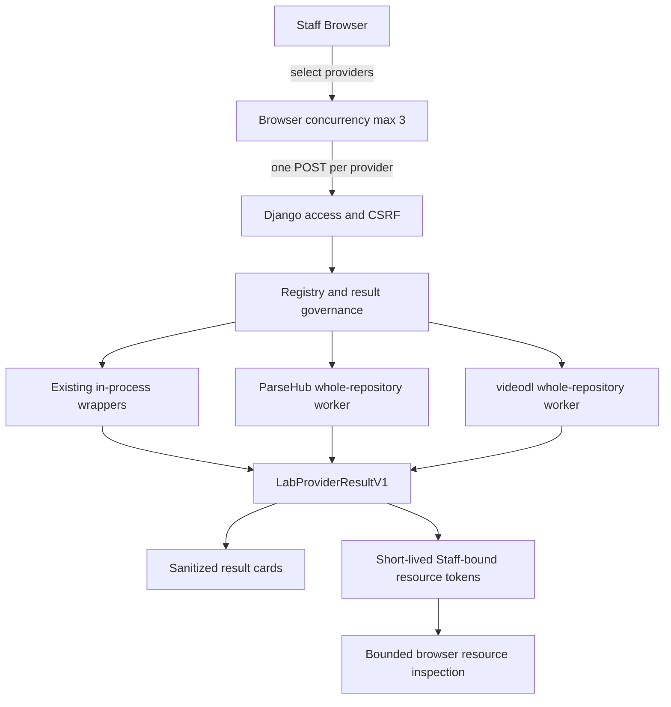

# Provider Lab

Provider Lab 是 AnimeImages Django monolith 内的 Staff-only 上游对比工具。它用于在不改变正式平台路线的前提下，并排检查现有 Provider 与隔离的 whole-repository Provider。

Provider Lab 不是公开解析产品、自动 Provider Planner、生产路由层或微服务。它不会选择赢家，也不会把实验结果写回正式 Registry。

## 当前状态

Provider Lab 已合并进入 development main，但本次文档任务没有记录它已部署生产。

```text
UPSTREAM_PROVIDER_LAB_ENABLED=False
VIDEODL_PROVIDER_LAB_ENABLED=False
PROVIDER_LAB_PRODUCTION_STATUS=NOT_DEPLOYED
```

普通 AnimeImages 开发启动不需要安装 ParseHub Provider Lab Worker 或 videodl Provider Lab Worker。

## 访问与权限

页面地址：

```text
/admin/provider-lab/
```

进入页面需要同时满足：

- 用户已认证；
- 用户为 active Staff；
- `UPSTREAM_PROVIDER_LAB_ENABLED=True`。

页面访问与单个 Provider 可用性彼此独立。即使 ParseHub、videodl、
yt-dlp 或 TianTian 尚未配置，满足以上页面 Gate 的 Staff 仍可进入
Provider Lab；对应卡片显示 `unavailable` 或 `not configured`。

单个 Provider 是否可运行取决于各自的：

- Provider-specific flag；
- venv、Python binary 或外部工具 binary；
- API configuration；
- license boundary。

所有 Provider POST 都使用 CSRF、请求限流和 single-flight 约束。匿名和普通登录用户得到 fail-closed 响应。

Provider Lab 没有以下公开发布模式：

- `disabled / staff / public_gray / public` Runtime exposure；
- 匿名 rollout percentage；
- 平台 public allowlist；
- 通过 `/admin/provider-settings/` 开放 Lab。

正式 Provider Runtime Gate 与 Lab Gate 是两套不同体系，见 [Provider Runtime Gates](provider-runtime-gates.md)。

## 固定 Provider 清单

Registry 显式列出五个 Provider：

| Provider ID | 类型 | 运行位置 | 用途 |
| --- | --- | --- | --- |
| `animeimages_current` | 现有正式能力包装 | Django 进程内 | 观察 AnimeImages Current 归一结果 |
| `parsehub_repo` | whole-repository Provider | 隔离 Python Runtime | 对比 ParseHub 仓库的 parse-only 能力 |
| `videodl_repo` | whole-repository Provider | 隔离 Python Runtime | 非商业本地 Staff Lab 对比 |
| `yt_dlp_existing` | 现有工具包装 | 受控外部工具路径 | 观察当前 yt-dlp 行为和失败隔离 |
| `tiantian_existing` | 现有 Provider 包装 | 当前受控 Provider 路径 | 对比 TianTian 解析结果 |

固定 Registry 防止用户通过请求参数加载任意 Python 包、命令或 Provider。添加新 Provider 必须经过代码审查；页面不会扫描本机环境自动发现工具。

## Whole-Repository Provider

Whole-repository Provider 指以固定 commit 的完整上游仓库作为隔离解析能力运行，而不是把其依赖安装到 AnimeImages 应用 `.venv` 或将源码复制进项目。

当前 exact pins：

```text
ParseHub=144260f4349c5bb57415f7555a572fcd48c3b8ba
videodl=6cd1de0fe1209380b183b654c65e98a629637873
```

每个仓库使用独立 venv，并通过受控 Worker 适配为统一结果。升级 pin 是独立的供应链和行为审查，不应随普通依赖更新自动发生。

## 隔离模型

ParseHub 和 videodl Worker 具有以下边界：

- 一次 Provider POST 启动一个有界子进程；
- JSON request 从 stdin 输入，JSON result 从 stdout 输出；
- stdout 和 stderr 都有字节上限；
- 使用临时 `HOME`、XDG 目录和 CWD；
- 不继承用户 Cookie 或代理；
- Provider downloader 被禁用，只允许 parse-only；
- timeout、输出溢出、callback 异常或父进程退出都会清理进程树；
- 原始上游异常和 URL 不直接返回浏览器。

这仍然是 Django 应用内的一项模块能力，外部仓库 Runtime 只是隔离执行环境，不是独立微服务。

## 架构



重要语义：

- 浏览器最多并发 3 个 Provider；
- 每个 Provider 是独立 POST；
- 服务端不自动 fan out；
- 一个 Provider 失败不阻塞其它结果；
- Lab 不计算全局分数，也不选择正式赢家；
- Lab 不修改平台路线或 Runtime Setting；
- 刷新页面清除结果；
- 服务端不做完整媒体 Relay。

## 初始化 Runtime

建议把 Provider-specific venv 放在项目目录以外。以下命令会按仓库内固定配置准备 exact-pin Runtime。

ParseHub：

```bash
python tools/provider_lab/runtime/bootstrap_provider.py \
  --provider parsehub \
  --target /tmp/animeimages-provider-lab/parsehub
```

videodl：

```bash
python tools/provider_lab/runtime/bootstrap_provider.py \
  --provider videodl \
  --target /tmp/animeimages-provider-lab/videodl
```

只检查现有 Runtime，不安装或更新：

```bash
python tools/provider_lab/runtime/bootstrap_provider.py \
  --provider parsehub \
  --target /tmp/animeimages-provider-lab/parsehub \
  --check-only
```

对 videodl 执行 check-only 时，将 `--provider` 和 `--target` 改为对应值。

初始化过程应验证：

- checkout commit 与固定 pin 一致；
- 包版本和关键 import 可用；
- Worker handshake 成功；
- Downloader 保持禁用；
- Runtime 不依赖用户 HOME 中的隐式包。

## 本地配置

最小本地示例：

```text
UPSTREAM_PROVIDER_LAB_ENABLED=True
PARSEHUB_PROVIDER_LAB_PYTHON=/tmp/animeimages-provider-lab/parsehub/bin/python
VIDEODL_PROVIDER_LAB_ENABLED=True
VIDEODL_PROVIDER_LAB_PYTHON=/tmp/animeimages-provider-lab/videodl/bin/python
```

这些值只用于本地或明确授权的 Staff Lab 环境。本指南不要求修改仓库的环境变量示例，也不表示生产应启用 Provider Lab。

配置后先运行：

```bash
python manage.py check
python manage.py runserver
```

如果只需要现有 AnimeImages、yt-dlp 或 TianTian wrapper，可保持 videodl 附加开关关闭。

## 使用流程

1. 使用 active Staff 账号登录。
2. 打开 `/admin/provider-lab/`。
3. 输入任意待研究的公开 HTTP/HTTPS URL，或包含该 URL 的分享文案。
4. 只选择本次需要比较的 Provider。
5. 提交后分别观察每张 Provider 结果卡片。
6. 使用受限资源检查确认浏览器可读性、响应类型和小范围字节信号。
7. 刷新页面清理当前结果。

Lab 先把输入约束为公开 HTTP/HTTPS source，再由每个选中的 Provider
独立判断是否支持。`unsupported` 是有效结果。输入不要求已被正式
Platform Registry 识别；研究尚未进入正式 Registry 的平台正是
whole-repository Provider 的用途之一。

不要为了让结果“都变绿”而修改正式路线。Provider failure 是 Lab 的有效输出。

## Result Contract

所有 Provider 都归一化为 `LabProviderResultV1`。稳定语义包括：

- Provider ID 与固定状态；
- 平台、标题和作者等非敏感摘要；
- 资源数量、媒体类型、格式、尺寸和关系；
- 固定错误分类和受限诊断；
- 已脱敏的 `raw_shape`；
- 可选的短期资源 token。

Contract 不返回：

- 原始 Provider response body；
- Cookie、Authorization 或代理凭据；
- shell traceback；
- 未受约束的完整媒体 URL；
- 任意可执行命令。

Provider-specific 字段不能直接进入 UI。先在 Worker 中形成有界结构，再由 Django governance 层校验和脱敏。

## Resource Token 与浏览器检查

初始 HTML 和归一 JSON 不包含原始媒体 URL。需要检查资源时，Django 签发短期、Staff-bound 的 opaque token；浏览器再通过受限端点获取检查描述并直接访问上游。

检查能力用于回答：

- 浏览器是否能发起请求；
- 上游状态和 Content-Type 是否合理；
- 小范围 Range/body 是否可读；
- 候选是否暴露明显 HTML/JSON 错误体。

Resource inspection 不是完整文件完整性证明，也不是下载授权。需要完整字节等价时，应作为独立、有明确样本和清理要求的研究任务执行。

## 许可证边界

ParseHub 和 videodl 的 pin、许可证及使用范围必须分别审查。

videodl 当前许可证：

```text
PolyForm Noncommercial 1.0.0
```

因此当前边界固定为：

```text
videodl=noncommercial local Staff Lab only
```

videodl 不得进入：

- anonymous/public Provider；
- `public_gray` rollout；
- 正式平台路线；
- 生产候选或商业部署。

未来若要改变范围，必须先完成新的法律与许可证授权审查；技术可用性不能替代许可证授权。

## 无持久化

Provider Lab 不保存结果历史：

- 不写数据库结果模型；
- 不把媒体候选写入用户媒体库；
- 不在浏览器持久存储原始结果；
- 页面刷新后结果消失；
- token 只在短期缓存中存在并受 Staff 身份约束。

应用日志只能记录固定 Provider ID、阶段、状态和受限计数，不应记录用户输入或媒体 URL。

## 已知 Bilibili 结论

首次真实平台对比使用三个 Bilibili 视频样本。结果：

- AnimeImages Native、TianTian、videodl 和官方 DURL 的完整媒体字节一致；
- TianTian 未证明 Bilibili 质量增量；
- videodl 未证明 Bilibili 质量增量；
- ParseHub 提供额外格式元数据信号，但未形成可交付媒体候选；
- yt-dlp 返回 `PROVIDER_PROCESS_FAILED`，属于已知 Provider-specific 限制；
- 正式 Bilibili 路线保持 Native video-only。

这些结论证明 Lab 能隔离失败和支持路线决策，不代表所有平台或未来样本永远等价。

## 已知限制

- 默认关闭且仅限 Staff。
- 页面刷新会清除结果。
- 浏览器并发上限为 3，不保证所有 Provider 同时完成。
- Lab 不自动选择赢家。
- Resource inspection 不是完整媒体证明。
- 需要 Cookie、Referer 或特殊 Header 的资源可能无法浏览器检查。
- 外部仓库 schema 或依赖变化会使 Worker fail closed。
- yt-dlp 的 Bilibili 路径当前存在已记录的执行限制。
- videodl 受 noncommercial license boundary 限制。
- Provider Lab 未被本任务记录为已部署生产。

## videodl 受控执行

videodl Staff Lab 支持 `specific_backend`、`dedicated_only`、
`common_only`、`reviewed_auto` 和显式的 `legacy_auto` 对照。默认使用
`reviewed_auto`。backend category 只描述 registry，不代表内部执行或共享
行为。exact pin 的 70 个 dedicated backend 逐项审核为 60 个 `allowed`、
1 个 `requires_sharing_confirmation` 和 9 个 `blocked`；未知 dedicated
backend 默认阻止。exact pin 的 37 个 common backend 也逐项审核：21 个
`requires_sharing_confirmation`、16 个 `blocked`，不存在直接 `allowed` 的
common backend。未知 common backend 默认阻止；可执行 common 默认不选择，
且必须由 Staff 明确选择并确认 source reference 的外部共享。

受控模式只运行本地 exact-pin policy 明确允许的 backend。嵌套外部服务的
dedicated backend 必须确认共享或被阻止；需要 DrissionPage / Chromium、
内置 Cookie/Provider credential、TLS 校验绕过或未获准子进程的 backend
在启动 backend Worker 前阻止。受控模式不会进入未选择的 common、
WebMediaGrabber、Chromium 或 browser observer fallback。`legacy_auto` 仍可
用于显式不透明对照，但不是默认模式，也不作为受控执行完成证据。
Common 的共享确认只授权向所选服务发送 source reference，不会解除 TLS
校验、浏览器/交互执行、Provider-owned downloader、内嵌凭据或 Cookie 阻断。
`BugPkVideoClient` 因禁用 TLS 校验而固定阻断，即使已确认共享也不能执行。

AnimeImages 父进程拥有 backend 顺序、单次和总 deadline、selected
backend、固定安全错误及最多 12 条 attempt。失败结果也可显示已经真实
运行的 attempts；总 deadline 在下一 backend 启动前耗尽时保留已有
attempts，且不伪造下一条。表格和脱敏 JSON 不包含 URL、Header/Cookie 值、异常、
本地路径或外部 API 数据。

页面 inventory 区分 registry presence 与 controlled eligibility。运行时要求
70 个 dedicated 和 37 个 common registry ID 与本地 policy 完整集合相等，
缺失或新增 ID 均 fail closed。成功结果按 videodl pin、policy revision/file
identity 和 runtime identity 缓存 10 分钟，安全失败缓存 30 秒；并发冷加载由
短期 single-flight 锁合并。匿名或非 Staff 请求在 inventory Worker 前返回
404，缓存内容只含固定 backend 元数据，不含 source 或 media URL。

完整实现与 26 项组件处置见
[videodl Asset 1/2 outcome](research/videodl/ASSET_1_2_IMPLEMENTATION_OUTCOME_V1.md)。
这不会授权正式平台路线、公开访问、grabber 或生产部署。

## 添加 Whole-Repository Provider

新增 Provider 至少需要：

1. 固定仓库来源、exact commit 和许可证结论。
2. 为其建立独立 venv，不污染应用 `.venv`。
3. 实现 parse-only Worker handshake。
4. 禁用上游 downloader、Cookie 和隐式 proxy inheritance。
5. 设置 timeout、进程树清理和 stdout/stderr 上限。
6. 将结果归一为 `LabProviderResultV1`。
7. 对 `raw_shape`、错误和 URL 做脱敏。
8. 使用固定 Registry ID，不允许用户提供命令。
9. 增加 Staff、CSRF、rate-limit、single-flight 和 token 测试。
10. 记录该 Provider 只用于 Lab，不修改正式平台路线。
11. 通过真实样本研究证明价值后，再创建独立的产品路线提案。

Lab 集成和正式 Provider 集成必须是两个可独立审查的决定。

## 清理

停止本地服务后，可删除任务自建的隔离目录：

```bash
rm -rf /tmp/animeimages-provider-lab/parsehub
rm -rf /tmp/animeimages-provider-lab/videodl
```

只删除能够确认由当前 Lab 任务创建的目录和进程。不要删除应用 `.venv`、其它 worktree 或共享缓存。

## 故障排查

### 页面 404

检查 Staff 身份和 `UPSTREAM_PROVIDER_LAB_ENABLED`。Provider Lab fail closed，不会向匿名用户解释内部开关。

### ParseHub 或 videodl unavailable

运行对应的 `--check-only` 命令，核对 exact pin、Python 路径和 Worker handshake。不要把 Provider 包临时安装进应用 `.venv`。

### 单个 Provider process failed

先确认其它 Provider 是否正常。独立失败是预期隔离行为；使用固定错误分类定位 timeout、output limit、schema rejection 或 Runtime readiness，不回显原始异常。

### 资源检查失败

检查 token 是否过期、浏览器 CORS/Range 能力和上游 Content-Type。不要把 inspection failure 自动解释成正式 Provider route failure，也不要切换到 Server Relay。

### 结果在刷新后消失

这是无持久化设计，不是数据丢失缺陷。需要保留研究结论时，只归档脱敏统计和结构证据，不保存真实媒体 URL。

## 进一步阅读

- [Provider Lab v1 研究记录](research/provider_lab/01_UPSTREAM_PROVIDER_LAB_V1.md)
- [Provider Runtime Gates](provider-runtime-gates.md)
- [当前架构](architecture.md)
- [当前版本状态](current-version-status.md)
- [外部工具生命周期](research/parsehub/08_EXTERNAL_TOOL_LIFECYCLE.md)

稳定使用和维护以本指南为准；`docs/research/provider_lab/` 保存阶段性证据和历史决策。
