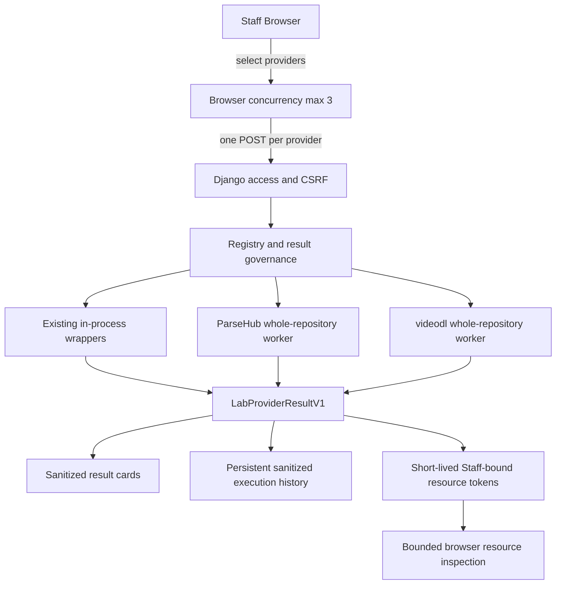

# Provider Lab

Provider Lab 是 AnimeImages Django monolith 内的 Staff-only 上游对比工具。它并排检查现有 Provider 与隔离的 whole-repository Provider；比较本身不会改变路线，具有配置权限的 Human 可以另外明确保存通用来源 Host 的路线。

Provider Lab 不是公开解析产品、自动 Provider Planner 或微服务。它不会选择赢家，也不会把实验结果写回正式 Registry。人工路线不覆盖已有成熟平台的严格路线。

本页无日期的操作说明按当前 main 核对；带日期的验收段落保留当时状态、配置与失败事实，不代表最新生产或当前公开权限。版本与部署集中见 [当前版本状态](current-version-status.md)。

## 平台总表与持续收录（2026-10-16）

`/admin/provider-lab/` 默认打开“平台总表”；“即时测试”和“执行记录”保留。
直接搜索 hostname、筛选内容/Provider/证据/路线，再进入平台的跨批次作品比较、
按需候选详情与原路线编辑器，不需要先选批次。平台没有可信名称时只显示实际
hostname，作品标题不作为平台名称；同平台不同 hostname 不自动合并。

总表派生于本应用全部 `EvaluationExecution`、批次来源和 `UpstreamRoute`。
包括失败记录、无记录但已配置的路线；来源未保留的记录有单独入口。
未导入私有档案不纳入，行数不是新增支持平台数，也不是公众能力白名单。
历史正向证据与最近结果分别显示；日期只取记录的实际观察时间，不用建档时间
补造。原生观察、离线转换、产品执行、部分失败媒体与未执行保持区分。
产品成功返回候选不等于目标身份已确认；没有明确身份确认依据时保留成功状态和
候选，能力证据标为“未确认媒体”，不补造确认，也不改成不支持。
关联 Lab/Scout 副本在统计中去重，真实重测保留。复合路线基线单列，不算独立上游。

摘要读取采用分块投影，不受旧批次列表 100 项或旧跨批次接口 200 项限制。
详情记录与候选分别分页，单条过大的旧记录只缩减展示字段并明确标注，不阻断
后续页。页面中的候选排序只针对已加载项；原始上游顺序与未加载总量保留。
平台行中的上游摘要有预览上限，详情的上游摘要另行分页，不影响全部记录的
统计和筛选。过长作品引用只从展示/带入操作省略，不改原始历史或作品比较身份。
表格不生成资源授权、预览或下载请求。没有可安全带入的作品时，“补充测试”
进入空输入状态，不猜链接；打开或填入不会发送解析。

没有额外平台表或持久汇总缓存。每次打开/手动刷新读取现有记录，因此 Lab
执行结束、Scout 正常导入、原记录更新及路线变更都能反映在下一次读取；不需
手动登记平台，也不以最大 ID 代替更新检测。外部导入无需页面后台轮询。
摘要不逐行启动 Worker；Provider 当前可用性是页面加载时的配置快照，历史
能力不会因当前关闭而删除。

路线 API 新增与 `source_url` 互斥的 `source_host` 选择器，支持无作品引用时
读取和编辑精确 host。权限、CSRF、成熟路线保护、revision 冲突和审计保持；
无作品时不探测可执行性，videodl 状态明确为未检查。设首选/备选只改草稿，
切换平台保留本页未保存草稿，较新服务器 revision 会使旧草稿失效。明确保存
后总表刷新；取消、浏览与比较不写路线。内容筛选不是内容类型路由，任何保存
仍作用于整个精确 host。Common/未知选项不能继承旧 Dedicated 参数。

新只读查询复用 `/admin/provider-lab/history/`：`view=platforms` 是全范围摘要，
`view=platform&source_host=...` 是分页详情，`execution_id=...` 按需读取候选。
同作品跨批次比较使用记录 ID 定位，浏览器状态中不保存签名链接或资源 Token。
所有接口继续受 Staff 与 Lab Gate 保护。

## 本地质量比较与人工路线增量

### 分阶段发布候选修正（2026-10-11）

历史单项复测现由后端对原记录状态进行类型检查、去除首尾空白和大小写
规范化，仅接受已知终态或明确未执行状态。`queued`、`waiting`、缺失、空值
和非法状态均拒绝；`SERVICE_PREVIOUS_OUTCOME_UNKNOWN` / `OUTCOME_UNKNOWN`
仍阻止重发。判断不改写原摘要、时间、来源或指纹。前端使用一致判断，
实际 POST 继续校验当前权限、原作品、Provider 和授权。

发布审查同时恢复既有 yt-dlp 单作品 HTTPS MP4 有界轨道探测，避免未知
轨道候选丢失原有下载准入证据。每次解析至多探测一个候选，沿用两请求、
五秒及剩余执行/字节预算；不遍历集合、不伪造 codec、不增加下载权限。

本地浏览器核验了 DokiTool 身份、历史矩阵、复测确认/取消及路线草稿取消；
未执行真实解析、未保存路线，原历史和路线摘要保持一致。隔离 PostgreSQL 16
完成 `0026 -> 0027 -> 0028 -> 0026 -> 0028` 演练，开发基线旧代码能连接
升级库读写旧模型，新四表数据保持不变。这不是生产现场兼容或依赖回退证据。
生产发布、备份恢复和真实下载结果以本次发布记录为准，不由上述本地检查推定。

### 统一评估工作区（本地开发，2026-09-29）

Provider Lab 的“批次与历史”与即时测试共用候选展示和人工路线编辑器。
Scout 通过受 Staff、CSRF 和现有 Lab Gate 保护的
`/admin/provider-lab/history/` 同步结构化摘要，不上传 HTML，不重跑解析。
迁移 `0028_evaluation_history` 保存批次及执行摘要，缓存失效或进程重启
不删除这些历史；普通公开解析不自动进入此库。

同一批次/执行身份重复上传不增加记录，内容冲突返回 409。后续执行可追加；
计划观测和实际执行保留各自身份与关联。Scout 导入保持来源标记，能关联
应用执行 ID 时建立关联，但不声称服务端重新核验了旧结果。
同步失败仅重试上传，不能补发解析请求。客户端调用账本仍在 Scout 私有目录。

历史候选保留当时实际存在的字段，未保存的信息仍是缺失/未知。最多接收
1,000 个已有候选，不做前 64 项截断。媒体 URL、资源 Token、Cookie 和
Authorization 不成为持久摘要；敏感来源链接不保留为可重测入口，也不通过
删除签名参数猜造新来源。历史渲染、筛选、排序和候选选择不读取媒体。
资源访问需要一次明确的新解析，导入不重新签发或延长授权。

从历史结果准备路线草稿不需要重新解析。当前 Provider/Backend 能力、
配置权限、来源 Host、成熟路线保护和 revision 检查仍由原路线服务执行。
显式保存的审计关联参考执行 ID、批次及摘要指纹；取消草稿不会写路线。
旧候选 ID、临时格式 ID 和媒体 Host 不能用作永久路线。

指定项复测仍走原 Lab 执行入口，生成新时间/版本的记录并关联原记录。
未知、已发送但未确认的旧请求不提供自动复测；导入本身不授权新的外部调用。
解析成功但摘要保存失败会单独标记，不能把保存失败当成重发理由。
新接口不启动 Scout shell、后台调度器或远程任务。

本增量依赖 PR #88，仅供独立本地体验，不表示生产已部署。
普通通用解析和 Lab 共用 `quality_execution` 的执行与候选归一化。
`animeimages_current` 是复合路线基线，不是额外独立上游。

- 各上游独立完成，默认最多并发 3 项，而非总共只能执行 3 项；可取消、单项重试，旧请求不污染新比较。
- 候选保留宽高、格式、帧率、编码、码率、大小与估计标记。缺失值显示未知，上游声明不等于实测画质。
- 分离轨、音轨、流媒体、未知轨道与 HTTP 引用可以作为受限候选存在；这不授予下载权限，也不新增合流或服务器 Relay。
- “本次选择”只改变页面当前候选。“保存为平台路线”需显式确认，写入来源 Host、上游顺序、受控 Backend 和可复用格式偏好，不保存媒体 URL 或临时 Token。
- 路线使用数据库 revision 防止旧页面覆盖新修改，并保留基本审计。恢复默认是另一项明确操作；解析失败不删除人工配置。
- 通用候选信息可供已获准解析的用户查看、复制或打开；候选 URL 仍由短期信息令牌和当前访问 Gate 控制，成熟平台的特殊权限不变。
- 资源所需请求上下文只保留在受控缓存中，前端仅显示条件标记；不返回 Cookie 或 Authorization 值。

迁移 `0027_upstream_manual_routes` 新增路线及修改记录，不改变邮件、Daily 或生产配置。
未人工优选的来源仍按允许的通用默认顺序尝试；比较页面不会自动保存最快或首个成功结果。

### 初始验收记录（2026-09-08，本地，修正前）

- 完整 Django 2,330 项、Node 291 项、独立 Worker 安全/广度测试 19 项通过；迁移漂移与 Django check 通过。
- 确定性测试覆盖独立结果、分离轨保留、超时隔离、选择不写路线、修订冲突、恢复默认、真实缓存失效及普通/Batch 路线消费。
- Chrome 下酷安同一公开作品由 ParseHub 返回 8 项；所选 gallery-dl、yt-dlp 分别返回不支持，不抹除成功结果。这不是两个独立上游均成功的证据。
- Chrome 本次选择不改变 revision；明确保存后，新首页解析返回 8 项并标明手动 ParseHub 路线。新 Django 命令亦读到保存结果，候选复制成功但不计为下载。
- 1440/820/390 宽度检查无横向溢出，页面 JavaScript 异常为 0。
- 本地 videodl Runtime、收费服务未配置；videodl 受控匹配和执行接线以隔离离线测试验证。新功能不构成生产启用许可。
- `IMPLEMENTATION_READY` 与 `LIVE_COMPARISON_PENDING` 分开：同作品两个独立真实上游成功的验收仍缺失，没有新增自动保存成功统计。

浏览器取消会停止排队/等待并隔离迟到结果；已经进入服务端的执行仍受其既有子进程 deadline 和清理机制约束，不声称关闭 fetch 能瞬时终止服务端进程。

### 候选保真修正（2026-09-08，本地）

旧实现的 64 项前缀截断已由失败测试复现：尾部 2160p、音频与编码/容器偏好候选会丢失，缓存亦只保留截断结果。
当前共享路径在既有有界输出内保留最多 1,000 项精简描述，候选及 Lab 资源分别使用有界缓存 bundle，避免默认缓存容量淘汰同一结果的前部资源。
每个 bundle 仍受 2 MiB、有效期、权限、资源绑定与使用次数限制；候选描述不产生下载授权。
旧受控 Lab Worker 的 64 项硬预算没有扩大，触及该层或输出字节预算时仍须报告未展开范围。
页面初始显示 64 项，可继续展开；视频分辨率排序在完整保留结果中进行，不重排正文图片，展开与排序不改变候选身份或本次选择。
“返回、保留、已显示、待展开、上游未展开”分别呈现，触及硬上限不表示已经取得全量最高画质。

内嵌音轨与独立音频资源分开记录。轨道未知、仅视频但配对未知时，合并需求保持未知；不由缺失值生成 false，也不将任意音频配给所有视频。
上游明确角色、合并标记及同作品显式关系继续保留；描述性关系不扩大授权。

真实比较限定为三个公开作品、七次直接 parse-only 调用，没有媒体下载：

| 脱敏样本 | 独立实现 | 实际结果 |
| --- | --- | --- |
| BILI-VIDEO-1 | ParseHub BiliParse / yt-dlp BiliBili | ParseHub 1 项，声明 640×360；yt-dlp 在 extract 阶段 DownloadError |
| BILI-DYNAMIC-2 | ParseHub BiliParse / yt-dlp BiliBiliDynamic / gallery-dl BilibiliArticleExtractor | 分别 ParseError / DownloadError / HttpError，没有有效候选 |
| BILI-VIDEO-3 | ParseHub BiliParse / yt-dlp BiliBili | ParseHub 1 项，声明 3840×1920；yt-dlp 在 extract 阶段 DownloadError |

直接调用观察窗口为北京时间 16:27–16:32。尺寸仅为上游声明，不是媒体实测。
开发中两次页面调用显示通用失败，未取得内部阶段证据，不归因为 CORS 或源站拒绝。
冻结修正后的 Chrome 再做一次 ParseHub 页面核验：BILI-VIDEO-1 成功返回并显示 1 项候选，未知轨道/合并/独立音频仍为未知；选择候选未修改路线，未点击媒体检查或下载。
这次复核不抹除此前失败，也不将其算成第二个独立上游。

`INDEPENDENT_UPSTREAM_SUCCESS_COUNT_PER_SAME_WORK = 1`，`LIVE_COMPARISON_PENDING = YES`。
没有冒充两个包装入口为独立成功，没有继续扫描网站，没有修改本地人工路线或生产。

修正后完整 Django 2,372 项、Node 295 项、独立 Worker 26 项通过；Django check、迁移漂移与 JS 语法检查通过。
针对性回归包括 64 项后部高清/编码偏好、355 项默认缓存保留、图片顺序、未知及显式关系、资源过期/撤销和使用预算。
资源 bundle 的并发测试复现并修正了短锁租期过期后旧请求回写的问题：过期请求不能继续授权，单资源仍最多使用十次。
本次未新增迁移、依赖或 Workflow 改动；PR 原有路线迁移不等于本轮新增迁移。新 Head CI 以 PR 实际运行结果为准。

## 当前状态

Provider Lab 基础代码已有部署记录，但最近记录仍关闭生产页面；#97 的平台总表和 #98 的固定 Common 路线属于后续已合并、未记录部署的增量。本文没有实时核验生产。

以下是代码默认值，不是本文读取的运行实例配置：

```text
UPSTREAM_PROVIDER_LAB_ENABLED=False
VIDEODL_PROVIDER_LAB_ENABLED=False
```

普通 AnimeImages 开发启动不需要安装 ParseHub Provider Lab Worker 或 videodl Provider Lab Worker。

## 访问与权限

页面地址：

```text
/admin/provider-lab/
```

进入页面需要同时满足：

- 用户已认证；
- 用户为 active Staff；
- `UPSTREAM_PROVIDER_LAB_ENABLED=True`。

页面访问与单个 Provider 可用性彼此独立。即使 ParseHub、videodl、
yt-dlp 或 TianTian 尚未配置，满足以上页面 Gate 的 Staff 仍可进入
Provider Lab；对应卡片显示 `unavailable` 或 `not configured`。

单个 Provider 是否可运行取决于各自的：

- Provider-specific flag；
- venv、Python binary 或外部工具 binary；
- API configuration；
- license boundary。

所有 Provider POST 都使用 CSRF、请求限流和 single-flight 约束。匿名和普通登录用户得到 fail-closed 响应。

Provider Lab 没有以下公开发布模式：

- `disabled / staff / public_gray / public` Runtime exposure；
- 匿名 rollout percentage；
- 平台 public allowlist；
- 通过 `/admin/provider-settings/` 开放 Lab。

正式 Provider Runtime Gate 与 Lab Gate 是两套不同体系，见 [Provider Runtime Gates](provider-runtime-gates.md)。

## 固定 Provider 清单

Registry 显式列出七个入口：六个独立通道和一个复合基线。

| Provider ID | 类型 | 运行位置 | 用途 |
| --- | --- | --- | --- |
| `animeimages_current` | 现有正式能力包装 | Django 进程内 | 观察 AnimeImages Current 归一结果 |
| `parsehub_repo` | whole-repository Provider | 隔离 Python Runtime | 对比 ParseHub 仓库的 parse-only 能力 |
| `videodl_repo` | whole-repository Provider | 隔离 Python Runtime | 非商业本地 Staff Lab 对比 |
| `yt_dlp_existing` | 现有工具包装 | 受控外部工具路径 | 观察当前 yt-dlp 行为和失败隔离 |
| `gallery_dl_existing` | 现有工具包装 | 受控外部工具路径 | 与普通通用解析共享候选承接 |
| `tiantian_existing` | 现有 Provider 包装 | 当前受控 Provider 路径 | 对比 TianTian 解析结果 |
| `kukutool_existing` | 现有 Provider 包装 | 当前受控 helper 路径 | 对比 Kukutool 解析结果 |

固定 Registry 防止用户通过请求参数加载任意 Python 包、命令或 Provider。添加新 Provider 必须经过代码审查；页面不会扫描本机环境自动发现工具。

## Whole-Repository Provider

Whole-repository Provider 指以固定 commit 的完整上游仓库作为隔离解析能力运行，而不是把其依赖安装到 AnimeImages 应用 `.venv` 或将源码复制进项目。

当前 exact pins：

```text
ParseHub=144260f4349c5bb57415f7555a572fcd48c3b8ba
videodl=6cd1de0fe1209380b183b654c65e98a629637873
```

每个仓库使用独立 venv，并通过受控 Worker 适配为统一结果。升级 pin 是独立的供应链和行为审查，不应随普通依赖更新自动发生。

## 隔离模型

ParseHub 和 videodl Worker 具有以下边界：

- 一次 Provider POST 启动一个有界子进程；
- JSON request 从 stdin 输入，JSON result 从 stdout 输出；
- stdout 和 stderr 都有字节上限；
- 使用临时 `HOME`、XDG 目录和 CWD；
- 不继承用户 Cookie 或代理；
- Provider downloader 被禁用，只允许 parse-only；
- timeout、输出溢出、callback 异常或父进程退出都会清理进程树；
- 原始上游异常和 URL 不直接返回浏览器。

这仍然是 Django 应用内的一项模块能力，外部仓库 Runtime 只是隔离执行环境，不是独立微服务。

## 架构



重要语义：

- 浏览器最多并发 3 个 Provider；
- 每个 Provider 是独立 POST；
- 服务端不自动 fan out；
- 一个 Provider 失败不阻塞其它结果；
- Lab 不计算全局分数，也不选择正式赢家；
- 比较不修改平台路线；仅具有配置权限的 Human 明确保存时更新通用 Host 路线，不修改 Provider Runtime Setting；
- 刷新可清除即时卡片，但已保存的脱敏执行历史仍可查询；
- 服务端不做完整媒体 Relay。

## 初始化 Runtime

建议把 Provider-specific venv 放在项目目录以外。以下命令会按仓库内固定配置准备 exact-pin Runtime。

ParseHub：

```bash
python tools/provider_lab/runtime/bootstrap_provider.py \
  --provider parsehub \
  --target /tmp/animeimages-provider-lab/parsehub
```

videodl：

```bash
python tools/provider_lab/runtime/bootstrap_provider.py \
  --provider videodl \
  --target /tmp/animeimages-provider-lab/videodl
```

只检查现有 Runtime，不安装或更新：

```bash
python tools/provider_lab/runtime/bootstrap_provider.py \
  --provider parsehub \
  --target /tmp/animeimages-provider-lab/parsehub \
  --check-only
```

对 videodl 执行 check-only 时，将 `--provider` 和 `--target` 改为对应值。

初始化过程应验证：

- checkout commit 与固定 pin 一致；
- 包版本和关键 import 可用；
- Worker handshake 成功；
- Downloader 保持禁用；
- Runtime 不依赖用户 HOME 中的隐式包。

## 本地配置

最小本地示例：

```text
UPSTREAM_PROVIDER_LAB_ENABLED=True
PARSEHUB_PROVIDER_LAB_PYTHON=/tmp/animeimages-provider-lab/parsehub/bin/python
VIDEODL_PROVIDER_LAB_ENABLED=True
VIDEODL_PROVIDER_LAB_PYTHON=/tmp/animeimages-provider-lab/videodl/bin/python
```

这些值只用于本地或明确授权的 Staff Lab 环境。本指南不要求修改仓库的环境变量示例，也不表示生产应启用 Provider Lab。

配置后先运行：

```bash
python manage.py check
python manage.py runserver
```

如果只需要现有 AnimeImages、yt-dlp 或 TianTian wrapper，可保持 videodl 附加开关关闭。

## 使用流程

1. 使用 active Staff 账号登录。
2. 打开 `/admin/provider-lab/`，默认从“平台总表”按 hostname 查看跨批次证据；“执行记录”可按批次查看原记录。
3. 需要新比较时进入“即时测试”，输入适用的公开 HTTP/HTTPS 作品链接或分享文案。只查看总表、详情和草稿不会解析。
4. 主操作为“测试全部上游”；限定比较时在高级选项中选择 Provider 并使用“测试所选上游”。关闭、缺授权或不可执行项不计实际执行。
5. 完成本次必要共享确认后提交，分别观察卡片与执行状态；一家失败不抹除其他结果。
6. 有需要才明确执行受限资源检查，确认浏览器可读性、响应类型和小范围字节信号。
7. 刷新后通过“执行记录”查看已保存摘要。短期资源授权不因历史存在而续签；保存失败只补同步，不重发解析。

Lab 先把输入约束为公开 HTTP/HTTPS source，再由每个选中的 Provider
独立判断是否支持。`unsupported` 是有效结果。输入不要求已被正式
Platform Registry 识别；研究尚未进入正式 Registry 的平台正是
whole-repository Provider 的用途之一。

不要为了让结果“都变绿”而修改正式路线。Provider failure 是 Lab 的有效输出。

## Result Contract

所有 Provider 都归一化为 `LabProviderResultV1`。稳定语义包括：

- Provider ID 与固定状态；
- 平台、标题和作者等非敏感摘要；
- 资源数量、媒体类型、格式、尺寸和关系；
- 固定错误分类和受限诊断；
- 已脱敏的 `raw_shape`；
- 可选的短期资源 token。

Contract 不返回：

- 原始 Provider response body；
- Cookie、Authorization 或代理凭据；
- shell traceback；
- 未受约束的完整媒体 URL；
- 任意可执行命令。

Provider-specific 字段不能直接进入 UI。先在 Worker 中形成有界结构，再由 Django governance 层校验和脱敏。

## Resource Token 与浏览器检查

初始 HTML 和归一 JSON 不包含原始媒体 URL。需要检查资源时，Django 签发短期、Staff-bound 的 opaque token；浏览器再通过受限端点获取检查描述并直接访问上游。

检查能力用于回答：

- 浏览器是否能发起请求；
- 上游状态和 Content-Type 是否合理；
- 小范围 Range/body 是否可读；
- 候选是否暴露明显 HTML/JSON 错误体。

Resource inspection 不是完整文件完整性证明，也不是下载授权。需要完整字节等价时，应作为独立、有明确样本和清理要求的研究任务执行。

## 许可证边界

ParseHub 和 videodl 的 pin、许可证及使用范围必须分别审查。

videodl 当前许可证：

```text
PolyForm Noncommercial 1.0.0
```

既有非商业和已批准用途边界仍保留。当前代码已允许受控共享解析及明确保存的本地精确 host 路线，不能继续把实现描述为“任何正式路线均不可使用”。已接通 Common 仅限下文列出的具体 Backend，另需保存时的未来共享确认。

这些代码能力不自动授权匿名/public、生产或商业用途，也不扩大第三方服务的使用条件。超出已有批准范围而缺少独立许可证据的用途仍待核验，不能以技术成功作法律结论。

## 持久历史与短期资源

应用在 `EvaluationBatch` / `EvaluationExecution` 中保存脱敏批次与执行摘要，Worker 本身不写该库。保存的历史与即时资源凭据分别管理：

- Scout 导入保留来源、实际测试时间和关联身份，不冒称新的产品执行；
- 不把媒体候选写入用户媒体库；
- 不在浏览器持久存储原始结果；
- 刷新或进程重启不删除已保存摘要；普通公开解析不自动入此历史库；
- token 只在短期缓存中存在并受 Staff 身份约束。

查看旧记录不解析、不续签、不取得下载权限。解析结果与摘要保存结果分别报告；保存失败不构成重新调用上游的理由。

应用日志只能记录固定 Provider ID、阶段、状态和受限计数，不应记录用户输入或媒体 URL。

## 已知 Bilibili 结论

首次真实平台对比使用三个 Bilibili 视频样本。结果：

- AnimeImages Native、TianTian、videodl 和官方 DURL 的完整媒体字节一致；
- TianTian 未证明 Bilibili 质量增量；
- videodl 未证明 Bilibili 质量增量；
- ParseHub 提供额外格式元数据信号，但未形成可交付媒体候选；
- yt-dlp 返回 `PROVIDER_PROCESS_FAILED`，属于已知 Provider-specific 限制；
- 正式 Bilibili 路线保持 Native video-only。

这些结论证明 Lab 能隔离失败和支持路线决策，不代表所有平台或未来样本永远等价。

## 已知限制

- 默认关闭且仅限 Staff。
- 即时卡片和资源 token 不保证跨刷新可继续操作，持久摘要仍可查询。
- 浏览器并发上限为 3，不保证所有 Provider 同时完成。
- Lab 不自动选择赢家。
- Resource inspection 不是完整媒体证明。
- 需要 Cookie、Referer 或特殊 Header 的资源可能无法浏览器检查。
- 外部仓库 schema 或依赖变化会使 Worker fail closed。
- 早期 Bilibili 样本的 yt-dlp 失败保留为历史，不能据此判断当前全部 Bilibili 路径。
- videodl 受 noncommercial license boundary 限制。
- 基础 Lab 的部署与页面开放不同；当前增量和最后生产记录见版本状态页。

## videodl 受控执行

videodl Staff Lab 支持 `specific_backend`、`dedicated_only`、
`common_only`、`reviewed_auto` 和显式的 `legacy_auto` 对照。默认使用
`reviewed_auto`。backend category 只描述 registry，不代表内部执行或共享
行为。exact pin 的 70 个 dedicated backend 逐项审核为 60 个 `allowed`、
1 个 `requires_sharing_confirmation` 和 9 个 `blocked`；未知 dedicated
backend 默认阻止。exact pin 的 37 个 common backend 也逐项审核：21 个
`requires_sharing_confirmation`、16 个 `blocked`，不存在直接 `allowed` 的
common backend。未知 common backend 默认阻止；可执行 common 默认不选择，
且必须由 Staff 明确选择并确认 source reference 的外部共享。

受控模式只运行本地 exact-pin policy 明确允许的 backend。嵌套外部服务的
dedicated backend 必须确认共享或被阻止；需要 DrissionPage / Chromium、
内置 Cookie/Provider credential、TLS 校验绕过或未获准子进程的 backend
在启动 backend Worker 前阻止。受控模式不会进入未选择的 common、
WebMediaGrabber、Chromium 或 browser observer fallback。`legacy_auto` 仍可
用于显式不透明对照，但不是默认模式，也不作为受控执行完成证据。
Common 的共享确认只授权向所选服务发送 source reference，不会解除 TLS
校验、浏览器/交互执行、Provider-owned downloader、内嵌凭据或 Cookie 阻断。
`BugPkVideoClient` 因禁用 TLS 校验而固定阻断，即使已确认共享也不能执行。

AnimeImages 父进程拥有 backend 顺序、单次和总 deadline、selected
backend、固定安全错误及最多 12 条 attempt。失败结果也可显示已经真实
运行的 attempts；总 deadline 在下一 backend 启动前耗尽时保留已有
attempts，且不伪造下一条。表格和脱敏 JSON 不包含 URL、Header/Cookie 值、异常、
本地路径或外部 API 数据。

页面 inventory 区分 registry presence 与 controlled eligibility。运行时要求
70 个 dedicated 和 37 个 common registry ID 与本地 policy 完整集合相等，
缺失或新增 ID 均 fail closed。成功结果按 videodl pin、policy revision/file
identity 和 runtime identity 缓存 10 分钟，安全失败缓存 30 秒；并发冷加载由
短期 single-flight 锁合并。匿名或非 Staff 请求在 inventory Worker 前返回
404，缓存内容只含固定 backend 元数据，不含 source 或 media URL。

完整实现与 26 项组件处置见
[videodl Asset 1/2 outcome](research/videodl/ASSET_1_2_IMPLEMENTATION_OUTCOME_V1.md)。
单次 Lab 的这项执行确认不会授权未来正式路线、公开访问、grabber 或生产部署；后续已审查固定路线须走下述独立保存及共享确认。

## 添加 Whole-Repository Provider

新增 Provider 至少需要：

1. 固定仓库来源、exact commit 和许可证结论。
2. 为其建立独立 venv，不污染应用 `.venv`。
3. 实现 parse-only Worker handshake。
4. 禁用上游 downloader、Cookie 和隐式 proxy inheritance。
5. 设置 timeout、进程树清理和 stdout/stderr 上限。
6. 将结果归一为 `LabProviderResultV1`。
7. 对 `raw_shape`、错误和 URL 做脱敏。
8. 使用固定 Registry ID，不允许用户提供命令。
9. 增加 Staff、CSRF、rate-limit、single-flight 和 token 测试。
10. 记录该 Provider 只用于 Lab，不修改正式平台路线。
11. 通过真实样本研究证明价值后，再创建独立的产品路线提案。

Lab 集成和正式 Provider 集成必须是两个可独立审查的决定。

## 一条链接、全部上游与人工固定（2026-09-08，本地）

在现有 Lab 输入公开链接或分享文案后，主操作为“测试全部上游”；不预先寻找匹配交集。
页面从现有 Provider descriptors 生成队列，默认并发 3，逐项保留成功、不支持、失败、超时及未执行原因。
“测试所选上游”保留为高级操作。当前独立通道为 yt-dlp、gallery-dl、ParseHub、videodl、TianTian 和 Kukutool；
`animeimages_current` 是可选复合基线，不进入独立上游统计，也不能保存为赢家。
关闭、未配置或缺少授权的通道仍可见，但不计入实际执行。服务通道和可能调用服务的复合基线需要明确的本次调用确认；
后端同样检查确认，不能仅靠前端限制。执行数表示进入 Provider 检查，不等于联网请求数；本地匹配可以返回不支持。

成功候选的“本次选择”不修改路线。“将此上游设为该平台固定路线”仅准备单一首选草稿，
显示真实 source host、原路线、新 Provider、执行选项、格式偏好及明确备选，再经确认保存。
默认没有备选，首选失败即停止；有效但受限的候选不会触发降级。已有成熟平台保护不变。
保存的不是媒体 URL、Token 或 candidate ID。排序、展开、取消和重新比较不会自动保存路线。

执行 ID 复用共享执行器别名映射；新 Lab descriptor 必须对应可重复执行路径，否则标记不可保存。
TianTian/Kukutool 复用既有客户端，仅显式人工路线可授权普通通用解析调用，不加入默认尝试顺序。
其桥接结果当前是可比较的受限候选，不额外授予下载权限。账号未配置时只做离线接线验证。
新增上游仍需要独立评审执行边界，不能因注册到 Lab 就自动获得公开授权。

### 本轮真实浏览器证据

- Origin 为本地 8003，使用现有获准管理员会话和一个公开酷安样本；未预筛双上游交集。
- 纳入 6，实际执行 4：ParseHub 返回 8 项；videodl、yt-dlp、gallery-dl 返回不支持；失败 0、超时 0。
- TianTian/Kukutool 本地开关关闭，未执行；复合基线未调用。真实成功上游数为 1，未观察到双成功。
- 选择候选后 revision 仍为 2；确认保存后变为 3。原有 ParseHub 单一首选、空执行选项和格式偏好均未改变，没有添加备选。
- 新首页解析和 Batch 均返回 8 项，并显示“手动路线 · 本次上游：parsehub_generic”。新 Django 进程读到 revision 3。
- 图片预览仍失败，未点击下载，本轮不声明新增保存成功。同站另一作品未实测；不同链接、缓存失效及持久化由离线回归覆盖。
- videodl 使用既有 exact-pin bootstrap 安装到本任务独立本地 Runtime；其他体验环境不变，无生产访问。

之前的双上游比较失败记录继续保留；本轮验收目标已调整为全部检查和 Human 固定路线，不要求两个成功。

最终本地验证：Django 2,407 项、Node 300 项、独立 Worker 26 项通过；43 个 JS 文件语法、
Django check、迁移漂移、文档本地链接和 diff 检查通过。授权参数缺失及默认提交按钮反例已修正并回归。
本轮没有新增迁移、依赖或 Workflow 改动；PR 原有 `0027` 不变。新 Head CI 以实际运行记录为准。
首次 CI 中，新进程持久化测试继承非本地环境并清空缓存地址，触发现有 Redis 配置保护；
测试子进程现显式使用本地模式及临时 SQLite/内存缓存。应用保护和 Workflow 未放宽，失败记录保留。

## 本地平台证据与选路参考（2026-10-16）

当前日常入口为 `http://127.0.0.1:8000/admin/provider-lab/`。默认从“平台总表”
按实际来源 hostname 进入跨批次作品比较；“执行记录”保留按批次查阅。
可查看同一作品的各通道结果、当前路线、候选详情和选路参考；
“设为首选/加入备选”只修改草稿，明确确认并保存才改变路线。

原生采集的离线转换摘要标为“原生离线证据”，与产品解析成功分别计数。
保留目标身份、采集状态、完整性、未知字段及历史时间，不据此授予资源访问权限，
不把导入时间当成新解析时间。失败、未返回、身份未确认或只有封面的记录不形成媒体选路参考。
单一有效通道只表示当前证据中的唯一候选；不同作品、不同时间的结果不证明画质优劣。
尺寸、编码和码率是上游声明，未下载或目视比较时不宣称验证了最高画质。

正式路线的范围是精确 hostname，不按内容类型持久化，也不自动合并短链或别名。
既有成熟路线仍受保护。未知或聚合执行选项不能从首个媒体推断固定 Backend；
重新选择历史证据会重新核对执行选项，不继承先前草稿的不同 Backend 或共享授权。

### 已审查 Common 固定路线 v1

在固定 videodl `6cd1de0fe1209380b183b654c65e98a629637873` 下，首批仅接通
`GVVideoClient`（接收方 `greenvideo.cc`）与 `AnyFetcherVideoClient`（接收方
`anyfetcher.com`）。它们是两个具体 Backend，不代表所有 Common 或独立实现数量。
其他 Common 仍保留原 Lab 比较资格，不能因本增量自动成为持久路线。

保存选项为 `specific_backend`、`backend_category=common` 和唯一 `backend_id`。
无类别的旧 Specific Backend 继续解释为 Dedicated。保存使用原 Staff/配置权限、
CSRF、revision 和审计，另需明确确认精确 host、Backend、接收方、固定 Runtime
以及未来该 host 的已获准请求共享范围。单次 Lab、历史导入及普通解析参数不授予未来共享权限。
授权事实存于原 `provider_options` 并随审计记录；客户端不能提交或复制此授权事实。
换 Backend/host、重新保存或撤销均需重新核对，重置会移除授权，不存在任意短 TTL。

匹配不伪造 Dedicated 正则命中，而标为人工精确 host 授权；读取仍不发解析。
执行前重读当前持久路线，核对 revision、策略、接收方和 Runtime，再映射到原受控 Worker
的 Common 类别及单一 `backend_ids`。Common 不进入默认遍历，只使用明确配置的首选/备选。
缓存身份包含路线授权、类别、Backend、版本；撤销、策略阻止或 Runtime 不符时拒绝执行，
缓存故障不自动重发结果未知的远端操作。停止本地等待不等于远端已终止。

此功能不扩大匿名准入、来源权限或下载授权，也不创建内容类型路由。
保存对精确 host 的全部内容生效，不合并子域、短链或别名。实际新版本部署不属于此功能验收。
回归通过独立数据库的正常保存 API、全新进程、普通首页/Batch和真实 Worker 协议验证；
最终原生返回边界使用固定脱敏替身，不能写成新鲜服务成功或下载验收。

2026-09-08 小节中的“服务通道只允许人工路线”是当时状态：当前六个已接入通道
均可按实际配置、匹配和授权参与默认策略，人工路线仍优先且不被参考建议覆盖。
这不等于所有站点均开放，也不改变 Staff、匿名、Lab 和资源访问各自的边界。
历史摘要已持久保存；即时资源授权仍会过期，查看旧记录不会重新解析。

## 清理

停止本地服务后，可删除任务自建的隔离目录：

```bash
rm -rf /tmp/animeimages-provider-lab/parsehub
rm -rf /tmp/animeimages-provider-lab/videodl
```

只删除能够确认由当前 Lab 任务创建的目录和进程。不要删除应用 `.venv`、其它 worktree 或共享缓存。

## 故障排查

### 页面 404

检查 Staff 身份和 `UPSTREAM_PROVIDER_LAB_ENABLED`。Provider Lab fail closed，不会向匿名用户解释内部开关。

### ParseHub 或 videodl unavailable

运行对应的 `--check-only` 命令，核对 exact pin、Python 路径和 Worker handshake。不要把 Provider 包临时安装进应用 `.venv`。

### 单个 Provider process failed

先确认其它 Provider 是否正常。独立失败是预期隔离行为；使用固定错误分类定位 timeout、output limit、schema rejection 或 Runtime readiness，不回显原始异常。

### 资源检查失败

检查 token 是否过期、浏览器 CORS/Range 能力和上游 Content-Type。不要把 inspection failure 自动解释成正式 Provider route failure，也不要切换到 Server Relay。

### 结果在刷新后消失

先区分即时卡片与“执行记录”：刷新可以重置前者，后者应保留已保存的脱敏摘要。检查当次历史保存状态、筛选和导入同步，不把短期 token 失效当作历史删除。保存或同步失败只补该步骤，不为恢复页面重发解析；不要保存真实媒体 URL 来延长授权。

## 进一步阅读

- [Provider Lab v1 研究记录](research/provider_lab/01_UPSTREAM_PROVIDER_LAB_V1.md)
- [Provider Runtime Gates](provider-runtime-gates.md)
- [当前架构](architecture.md)
- [当前版本状态](current-version-status.md)
- [外部工具生命周期](research/parsehub/08_EXTERNAL_TOOL_LIFECYCLE.md)

稳定使用和维护以本指南为准；`docs/research/provider_lab/` 保存阶段性证据和历史决策。
