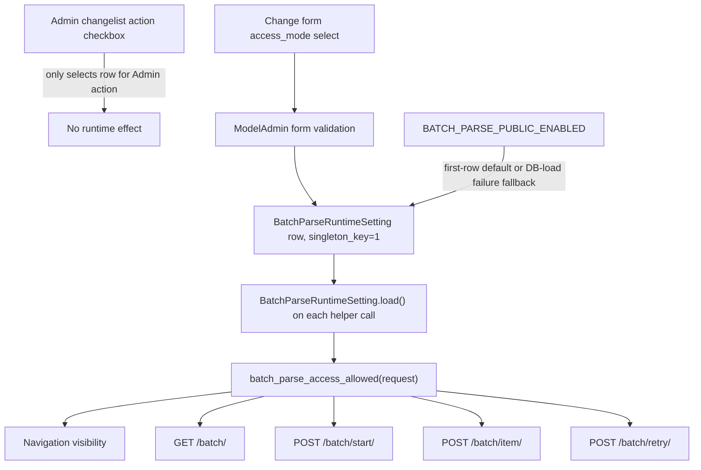

# Admin Runtime Control Surface Audit v1

Status: research only

Repository: `Daiobs/AnimeImages`

Base: `27c68b94710eeede6d0318d0cfe55cee87d39198`

Production mutation: not performed

Deployment: not performed

## 1. Executive Summary

The reported Batch symptom is reproducible and its root cause is confirmed.
`/admin/xhs_download/batchparseruntimesetting/` is a standard Django Admin
changelist. The checkbox at the left of its row is Django's action-selection
checkbox (`name="_selected_action"`); it selects an object for an Admin action
such as deletion. It is not the four-state Batch access control. The real
control is the `access_mode` select on the object's change form.

Saving `access_mode=public` writes the database immediately. Subsequent
requests load the persisted row and anonymous navigation, `/batch/`,
`/batch/start/`, `/batch/item/`, and `/batch/retry/` all use the same access
helper. Returning to the changelist therefore shows the row action checkbox
unchecked while Batch remains public. That is valid Django Admin behavior, but
the current interface makes the two meanings easy to confuse.

The audit found 11 mutable runtime or operational control surfaces:

| Risk | Count |
| --- | ---: |
| LOW | 1 |
| MEDIUM | 2 |
| HIGH | 7 |
| CRITICAL | 1 |

Across those surfaces, the main systemic issues are:

- Standard ModelAdmin pages expose saved values but not a distinct effective
  state, source, or apply result.
- Provider and Policy have multiple writers or effective-state sources.
- No mutable form implements optimistic concurrency; stale pages silently win.
- High-risk transitions generally have warnings but no risk-based confirmation.
- Audit quality varies from full before/after snapshots to Django's field-name
  log or no mutation audit at all.
- `Control Convergence` is presented as an analytical GET page but persists
  feedback fields on existing control records. It does not directly change
  live routing, so it is reported separately from the 11 runtime surfaces.

Recommended next PR: **Batch Runtime Admin Clarity v1**, scoped only to Batch.
Keep the native ModelAdmin for this first correction, remove the misleading
action-selection affordance, display saved/effective/source state explicitly,
add risk-based confirmation for public expansion, record before/after audit
data, and reject stale submissions. Do not combine Policy or a shared control
framework into that PR.

## 2. Reported Batch Symptom

Reported observation:

> After selecting full public access, refreshing appears to show the setting
> unselected, while anonymous Batch access remains open.

The user-visible ambiguity is between two different controls:

| Location | HTML control | Meaning | Persistent setting? |
| --- | --- | --- | --- |
| Changelist row | `input.action-select[name="_selected_action"]` | Select this database object for a Django Admin bulk action | No |
| Change form | `select[name="access_mode"]` | `disabled`, `staff`, `public_gray`, or `public` | Yes |

The changelist action checkbox is expected to clear after navigation or reload.
Its unchecked state says nothing about `access_mode`.

## 3. Reproduction

### 3.1 Environment

- Local-only Django server on `127.0.0.1:8011`
- Isolated temporary SQLite database
- Local temporary superuser
- No production database variables
- No production Admin mutation
- Installed Django version: `5.2.14`

Temporary credentials were not recorded in this report and are removed during
cleanup.

### 3.2 Browser reproduction

1. Opened `/admin/xhs_download/batchparseruntimesetting/`.
2. Confirmed it is a standard changelist with one row, an action selector, and
   the standard `Delete selected` action.
3. Opened the row's change page.
4. Changed the `access_mode` select from `staff` to `public` and clicked Save.
5. Observed a `302` redirect to the changelist and the success message.
6. Confirmed the access-mode column displayed `全站开放`.
7. Confirmed the row action checkbox remained unchecked after reload.
8. Reopened the change form and confirmed the select remained `public`.
9. Used browser back/forward; the action checkbox remained a transient row
   selection while the change form still represented the persisted value.
10. Opened anonymous `/batch/` and the home page through a separate host/session;
    Batch loaded and its navigation entry was visible.

The symptom is therefore stable when "selected" refers to the row action
checkbox. It is not reproducible as a database-save failure: the access-mode
column, change form, database, and anonymous behavior all agree on `public`.

### 3.3 Access matrix

Invalid API payloads were used only to distinguish an allowed gate (`400`) from
a rejected gate (`404`); no Provider or public network request was made.

| Saved mode | Rollout | Anonymous nav | Anonymous page | Anonymous start/item/retry | Staff page/API gate |
| --- | ---: | --- | ---: | --- | --- |
| `staff` | 0 | Hidden | 404 | 404 | Allowed; invalid payload returns 400 |
| `public` | 0 | Visible | 200 | Allowed; invalid payload returns 400 | Allowed |
| `public_gray` | 0 | Hidden for tested identity | 404 | 404 | Allowed |
| `public_gray` | 100 | Visible | 200 | Allowed; invalid payload returns 400 | Allowed |
| `disabled` | 0 | Hidden | 404 | 404 | 404, including staff |

The reverse transition from `public` back to `staff` also persisted and took
effect on the next request.

### 3.4 Save evidence

For each successful change-form submission:

- the form POST included `access_mode` and the remaining ModelAdmin fields;
- Django returned `302` to the changelist;
- the database row changed;
- `updated_at` changed;
- a fresh runtime-helper call observed the new value;
- navigation and all four Batch endpoints agreed with that value.

## 4. Confirmed Root Cause

**ROOT_CAUSE_CONFIRMED**

### Primary cause

Semantic confusion between Django Admin's changelist action checkbox and the
actual four-state `access_mode` field.

### Secondary contributing factors

- The changelist offers a selectable row even though the singleton has no
  meaningful runtime bulk action.
- There is no explicit panel separating saved DB value, effective access, env
  fallback, and form draft.
- "Save" and "takes effect on the next request" are not explained separately.
- The success redirect returns to a page where the most visually prominent
  checkbox is unrelated to the saved access mode.
- Public-expansion transitions have no second confirmation.
- The standard Admin log records actor, time, and changed field names, but not
  old/new values, request ID, or failed attempts.
- Stale forms are accepted without a version check.

### Not causes

- Not a failed database save.
- Not a BooleanField mismatch; `access_mode` is a `CharField` with four choices.
- Not a process cache or stale Gunicorn worker.
- Not a need to restart Gunicorn.
- Not a divergence between navigation, page, start, item, and retry gates.
- Not the `BATCH_PARSE_PUBLIC_ENABLED` env value overriding an existing DB row.

## 5. Batch State Flow



### 5.1 Source behavior

| Question | Finding |
| --- | --- |
| Existing DB row: can env change `access_mode`? | No. The row wins. |
| No row: what does first `load()` do? | `get_or_create(singleton_key=1, defaults=default_values())`; env chooses initial `public` or `staff`. |
| Admin save immediate? | Yes, standard ModelAdmin save followed by redirect. |
| Does each request read DB? | Yes. Access and limit helpers call `load()`; no process-level object cache was found. |
| Cache? | No Batch runtime-setting cache. |
| Stale object possible? | A Python instance already loaded in one request can become stale, but a fresh helper call loads a fresh object. |
| Restart needed? | No. The next request observes the DB value. |
| UI unchecked while DB is public? | Yes, if the unchecked control is the changelist action selector. |
| Multiple rows possible? | Yes, if code directly creates another distinct `singleton_key`. |
| Is singleton absolute? | No. `singleton_key` is unique, but only `load()` and Admin conventions target key `1`; the database does not constrain the table to one row total. |

Two consecutive loads executed two database queries and returned distinct Python
objects. A direct local creation with a different singleton key succeeded; that
test row was removed after verification.

## 6. Runtime Control Inventory

The inventory count includes mutable runtime settings and operational actions
that can trigger external work. It excludes purely observational pages. A row
can be a second writer for the same underlying domain.

### 6.1 Identity, storage, and lifecycle

| # | Control | Model / storage | URL | UI | Source | Singleton | Type | Immediate effect / restart | Rollout | Multiple entry | Risk | Batch-like issue |
| ---: | --- | --- | --- | --- | --- | --- | --- | --- | --- | --- | --- | --- |
| 1 | Batch Parse runtime | `BatchParseRuntimeSetting` | `/admin/xhs_download/batchparseruntimesetting/` | Standard Admin | DB; env first-row default/failure fallback | Intended key 1, not absolute | A | Next request; no restart | Yes | No | HIGH | Confirmed |
| 2 | Download runtime limits | `DownloadRuntimeSetting` | `/admin/download_console/downloadruntimesetting/` | Standard Admin | DB; env first-row defaults | Intended key 1, not absolute | A | Next request; no restart | No | No | HIGH | Yes |
| 3 | Provider runtime settings | `ProviderRuntimeSetting` | `/admin/provider-settings/` | Custom page; both model Admin entries redirect here | DB plus env capability, health/circuit state | Intended key 1, not absolute | F | Next request; no restart for DB | Yes | Yes | HIGH | Partial |
| 4 | KuKuTool emergency switch | cache key plus DB-derived effective check | `/admin/provider-health/control/` | JSON POST endpoint | Cache OR `ProviderRuntimeSetting.kukutool_disabled` | Cache key | F | Immediate in the cache scope; no restart | No | Yes | HIGH | Source ambiguity |
| 5 | Provider health test URLs | `ProviderHealthTestSetting` | `/admin/provider-health-tests/` | Custom form | DB | Intended key 1, not absolute | A | Next health test; no restart | No | No | MEDIUM | Partial |
| 6 | Provider health test execution | `ProviderHealthTestRun` plus outbound calls | `/admin/provider-health-tests/` | Custom action buttons | DB records plus current env/runtime/provider state | No | A, operational | Runs during POST; no restart | No | No | MEDIUM | No |
| 7 | Policy runtime, standard entry | `PolicyRuntimeSetting` | `/admin/xhs_download/policyruntimesetting/` | Standard Admin | DB plus env hard override/fallback | Intended key 1, not absolute | F | Next request; no restart for DB | Yes | Yes | HIGH | Yes |
| 8 | Policy Engine runtime | Same `PolicyRuntimeSetting` | `/admin/policy-engine/` | Custom page | DB plus env hard override/fallback | Same row | F | Next request; no restart for DB | Yes | Yes | HIGH | Partial |
| 9 | Policy Control workflow | `PolicyOptimizationProposal`, `PolicyControlRecord`, conditional rollback of Policy runtime | `/admin/policy-control/` | Custom workflow | DB workflow; current generated proposals are non-mutating | No | D | Proposals/status immediately; runtime only for eligible historical rollback | No | Yes, for Policy domain | HIGH | No, but scope is subtle |
| 10 | Self-Healing diagnostic | `SelfHealingEvent` | `/admin/self-healing/run/` | Custom action | DB event plus simulated failure handling | No | D | Records diagnostic event; no runtime setting/restart | No | No | LOW | No |
| 11 | Release Management | `ReleaseDeployJob`, local Git refs, env executor command | `/admin/release-management/` | Custom workflow | DB plus local refs plus env-gated external helper | One active slot | F | Creates job; may submit external executor immediately | No | No | CRITICAL | High-risk clarity gap |

Type legend:

- **A**: save to DB and the next runtime request/action sees it.
- **B**: save requires a cache refresh.
- **C**: save requires a process restart.
- **D**: proposal/diagnostic state; a separate action is required for live effect.
- **E**: env is authoritative.
- **F**: mixed or conditional source/effect.

No audited DB setting requires a Gunicorn restart. Env-only capability changes
remain process/deploy concerns and are not editable from these pages.

### 6.2 UI, save, effective-state, and audit properties

| # | Current value shown | Edit method | Save | Separate Apply | Confirm | Effective value shown | Unsaved marker | Actor | Audit | `updated_at` | Principal gap |
| ---: | --- | --- | --- | --- | --- | --- | --- | --- | --- | --- | --- |
| 1 | Saved DB value in list/form | Model form | Yes | No | No | No | No | Django LogEntry | Field names only | Yes | Action checkbox confusion; source/effective state hidden |
| 2 | Saved DB values | Model form | Yes | No | No | No | No | Django LogEntry | Field names only | Yes | Save and effective enforcement are conflated |
| 3 | Saved form plus capability/effective cards | Radios, fields, checkbox | Yes | No | Warning only | Yes | No | Yes | Before/after snapshot, changed fields, request ID | Yes | No stale guard; cache emergency source not separated |
| 4 | Effective health response only | JSON action | Endpoint is apply | No | No | Merged result | N/A | No | None | No | Cache-vs-DB source, scope, and actor are opaque |
| 5 | Saved URLs | Form | Yes | No | No | N/A | No | No change audit | None for config | Yes | URL changes are unaudited |
| 6 | Latest result cards | Action buttons | Action is apply | No | No | Yes, run result | N/A | Yes | Status/error/duration/runtime mode/capability/request ID | Created time | External calls/quotas need clearer risk cue |
| 7 | Saved DB values | Model form | Yes | No | No | No | No | Django LogEntry | Field names only | Yes | Env can override what UI claims is current |
| 8 | Saved DB values and derived metrics | Form | Yes | No | Warning only | DB-oriented, not full env-effective mode | No | Yes | Before/after snapshot, changed fields, request ID | Yes | Second writer; hidden env override; no stale guard |
| 9 | Proposal/status tables | Buttons | Workflow transition | Action-specific | No | `runtime_mutated` is shown | N/A | Mostly yes | Proposal/control history, incomplete request-level mutation audit | Multiple timestamps | Current no-op vs historical rollback requires careful reading |
| 10 | Recent event list | Button | Action is apply | No | No | Result message/event | N/A | Not stored on event | Event diagnostics, no actor | Created time | Operational action lacks actor attribution |
| 11 | Git/readiness/jobs | Button | Creates job | External executor conditional | No | Job status after submit | N/A | Create actor stored | Job lifecycle; cancel actor missing | Yes | Executor-enabled state is not shown before click |

## 7. Source-of-Truth Analysis

### Batch

The persisted key-1 row is authoritative after creation. Env supplies defaults
only when creating the first row and supplies a fallback only when loading the
database setting fails. The Admin does not show which path is active.

### Download

The persisted key-1 row is authoritative. Env values populate the first row.
Help text names env variables, but the page does not distinguish an inherited
default from a later operator value or display effective enforcement results.

### Provider

Provider availability is a composition rather than one value:

```text
DB access mode
+ env hard capability
+ allow/block lists
+ rollout decision
+ provider health/circuit state
+ KuKuTool disabled from DB OR emergency cache key
= request-effective result
```

The custom Provider page is the strongest current implementation because it
shows env capability and request-effective access. However, the emergency API
can write a cache-level disable state independently of the DB checkbox, and the
UI does not identify which source caused an effective disable.

### Policy

`POLICY_ENGINE_V35_ENABLED=true` hard-enables v3.5 before the database mode is
considered. Otherwise the key-1 DB row supplies the mode; if DB loading fails,
`POLICY_ENGINE_MODE` is the fallback. Both the standard Admin and the custom
Policy Engine page write the same DB row, but neither clearly presents this
precedence chain.

### Release

The page combines local cached Git refs, DB jobs, and
`RELEASE_MANAGEMENT_EXECUTOR_COMMAND`. A deployment POST creates a pinned job;
if the exact allowlisted executor command is configured, the request also
submits the external helper. The page does not present that executor state
before the operator clicks the create button.

## 8. Save vs Apply Semantics

| Control | EDIT | SAVE | APPLY | EFFECTIVE |
| --- | --- | --- | --- | --- |
| Batch | Browser form draft | ModelAdmin POST | Same transaction; no separate action | Fresh request reads DB |
| Download | Browser form draft | ModelAdmin POST | Same transaction | Fresh download path reads DB |
| Provider settings | Browser form draft | Custom POST | Same POST | Fresh request composes DB, env, rollout, health, cache |
| Provider emergency | JSON payload | None as separate concept | Cache write | Cache scope plus DB OR logic |
| Health URL config | Browser form draft | Custom POST | Used by later test | Next test uses DB URLs |
| Health execution | Selected test | Run record is created | Same POST runs test | Result is shown and persisted |
| Policy standard/custom | Browser form draft | Admin/custom POST | Same DB save | Fresh policy decision, subject to env override |
| Policy Control | Proposed workflow action | Proposal/transition persisted | Usually none; eligible rollback can restore runtime fields | Depends on `runtime_mutated` history |
| Self-Healing | Provider input | Event persisted | Diagnostic handler in same POST | No runtime setting change |
| Release | Notes/target action | Job persisted | External submit only when executor is configured | Async job/service result |

The largest terminology problem is that standard Admin screens correctly save
the database but never state whether that saved value is also the current
effective value. A dedicated Apply button is not automatically needed for
Type A controls; an explicit "saved and effective on next request" result is
often enough.

## 9. UI Truthfulness Gaps

The report counts a truthfulness gap when the operator cannot reliably separate
saved state, effective state, source, or unsaved draft. Seven inventory rows
meet that threshold:

1. Batch Runtime
2. Download Runtime
3. KuKuTool emergency control
4. Provider health URL configuration
5. Policy standard Admin
6. Policy custom page
7. Release Management

Provider Settings is not counted because it displays capability and effective
access, but it still has a dirty-state and source-detail weakness. Batch is the
only confirmed instance of the exact action-checkbox symptom.

Three standard Admin surfaces are marked with an apply-verification gap:
Batch, Download, and Policy. Their redirect confirms DB persistence, but not the
effective runtime outcome. Custom Provider/Policy pages use POST/redirect/GET;
Provider then shows effective cards, while Policy's remaining problem is the
hidden env precedence and is counted as a source-of-truth gap.

## 10. Auditability Gaps

The strict audit target is actor, timestamp, previous values, new values,
changed fields, request ID, and success/failure.

Substantial gaps exist in eight surfaces:

1. Batch standard Admin
2. Download standard Admin
3. KuKuTool emergency control
4. Provider health URL configuration
5. Policy standard Admin
6. Policy Control workflow
7. Self-Healing diagnostic
8. Release Management, specifically cancellation attribution and confirmation

Provider and Policy custom saves use `ProviderAdminAuditLog` with actor,
timestamp, request ID, changed fields, and before/after snapshots. That is the
best current pattern, though it records successful changes only and has no
explicit failed-attempt result field.

Provider health executions use `ProviderHealthTestRun` and adequately capture
the action's actor, request ID, status, safe error, duration, runtime mode,
capability, and test host. They intentionally do not persist full test URLs.

Standard Django `LogEntry` records actor and timestamp, but the observed change
message contained only field names, such as `开放模式`, not old/new values or a
request ID.

## 11. Concurrent Edit Findings

All tested mutable forms use last-write-wins behavior. No hidden `updated_at`
token, version field, `If-Match` equivalent, or stale-form warning was found.

### Batch standard Admin

- Admin A and B opened the same row.
- B saved `public`.
- A submitted the stale page with `staff`.
- Final value was `staff`; A received no stale warning.

### Provider custom page

- B saved `public`.
- A submitted the older form with `disabled`.
- Final value was `disabled`.
- Both accepted changes produced audit rows, but no conflict was reported.

### Policy cross-entry overwrite

- A opened the standard ModelAdmin form.
- B saved through `/admin/policy-engine/`.
- A submitted the stale standard form.
- A silently replaced B's mode/automatic-weight values.
- The custom save had a snapshot audit; the final standard save had only the
  Django field-name log.

Recommendation for later implementation: compare a submitted `updated_at` (or
explicit version) with the current row inside the save transaction and reject a
stale mutation with a visible conflict message.

## 12. Similar Modules

### Read-only or shadow pages

- Control Plane uses read-only setting getters and presents links/health.
- Rollout Guard calculates recommendations and does not apply them.
- Stability v6, Autonomous Evolution v7, and Governance v8 calculate shadow
  results; their GET views do not call the explicit governance audit writer.
- Policy learning snapshots used by the Policy page are pure; persistence is in
  the separate `record_policy_learning_run()` function.

### Control Convergence GET side effect

`/admin/control-convergence/` is GET-only at the view level, but
`build_control_convergence_snapshot()` calls
`apply_control_feedback_to_records()`. A local GET changed each in-window
`PolicyControlRecord`'s:

- `feedback_summary`
- `control_confidence`
- `drift_score`
- `consistency_score`
- `updated_at`

The local proof returned HTTP 200 and changed a test record's confidence from
`0.0` to `1.0`; the record was then deleted. Repository search found these
persisted fields used by the convergence presentation, not by the live routing
path. It is therefore an **analytical persistence side effect**, not one of the
11 live runtime control surfaces. Still, a page labeled as observational should
not silently write on GET; a later maintenance task should separate refresh or
materialization into an explicit, audited POST or scheduled job.

### Singleton initialization side effects

Several GET contexts call `load()`, which uses `get_or_create`. If a singleton
row is absent, merely opening the page can create the default row. This is a
one-time initialization write, not a routine state change, but it should be
documented and preferably moved to migration/bootstrap logic if strict GET
purity is required.

## 13. Risk Classification

### LOW

- Self-Healing manual diagnostic: writes a diagnostic event but is explicitly
  non-mutating for Provider/runtime state.

### MEDIUM

- Provider health test URL configuration: controls later outbound test targets.
- Provider health test execution: can call external Providers and consume time
  or quota, but does not change public runtime gates.

### HIGH

- Batch public access and limits
- Download public permissions, limits, and cost guard
- Provider modes, allowlists, budgets, and delivery settings
- KuKuTool emergency disable cache
- Policy standard runtime form
- Policy custom runtime form
- Policy Control workflow and conditional rollback

### CRITICAL

- Release Management because a POST can submit an external deployment executor
  when the env gate is configured.

### Risk-based confirmation rule

Require confirmation for:

- `disabled` or `staff` to `public_gray`/`public`;
- a large gray increase, especially to 100%;
- enabling a third-party Provider for public users;
- enabling adaptive/automatic runtime execution;
- restoring a historical Policy runtime snapshot;
- creating a deployment job when the executor is configured.

Do not require confirmation for every timeout, note, warning threshold, or
low-risk numerical edit. Those changes need dirty-state feedback and audit, not
confirmation fatigue.

## 14. Option A: Harden Native Admin

Scope:

- Start with Batch only.
- Set `actions = None` so the singleton changelist does not present a misleading
  action checkbox.
- Add a read-only saved/effective/source summary to the change form.
- State that Save is effective on the next request and does not need restart.
- Add risk-based confirmation for access expansion.
- Record before/after values and request ID.
- Add stale-form detection using `updated_at` or a version token.

| Dimension | Assessment |
| --- | --- |
| Complexity | Low to medium |
| Migration | Not necessarily; a generic audit model could be deferred |
| Regression risk | Low |
| UX quality | Good for a singleton with limited fields |
| Consistency | Improves Batch but not Policy yet |
| Auditability | Medium to high depending on audit storage |
| Maintenance | Low |
| Priority | **Recommended next** |

## 15. Option B: Dedicated Runtime Pages

Scope:

- Build dedicated Batch and later Policy pages modeled on the useful parts of
  Provider Settings.
- Present form draft, saved DB state, env/capability state, effective state, and
  last audit together.
- Use POST/redirect/GET, risk confirmation, and optimistic concurrency.
- Remove or redirect the corresponding ModelAdmin write entry so there is one
  writer per model.

| Dimension | Assessment |
| --- | --- |
| Complexity | Medium |
| Migration | Optional for UI; likely for a generic audit model |
| Regression risk | Medium |
| UX quality | High |
| Consistency | High once each duplicate writer is retired |
| Auditability | High |
| Maintenance | Medium; custom pages need dedicated tests |
| Priority | Second, after the Batch contract is proven |

Provider Settings should not be copied verbatim before adding dirty-state,
stale-form, cache-source, and failed-attempt behavior.

## 16. Option C: Shared Runtime Control Framework

Scope:

- Define a shared control contract for draft, saved, effective, source,
  confirmation policy, concurrency token, audit event, and post-save proof.
- Adapt Provider, Batch, Download, and Policy to the contract.
- Use one write entry per domain and make secondary pages read-only or redirect.

| Dimension | Assessment |
| --- | --- |
| Complexity | High |
| Migration | Likely for generic audit/version data |
| Regression risk | High because several live gates change together |
| UX quality | Highest when complete |
| Consistency | Highest |
| Auditability | Highest |
| Maintenance | Lower long-term, high initial cost |
| Priority | Later architectural work, not the next PR |

## 17. Recommended Next PR Scope

Create a single **Batch Runtime Admin Clarity v1** PR.

Include:

- remove the Batch singleton's Admin action checkbox;
- label the four-state access control explicitly;
- show saved DB mode, effective mode for staff/anonymous, rollout, source, and
  "no restart required";
- show a post-save effective-state confirmation;
- confirm only public-expansion transitions;
- add before/after/request-ID audit;
- reject stale forms;
- preserve the existing access helper and endpoint behavior.

Exclude:

- Policy changes;
- Provider refactor;
- a shared framework;
- model deletion or singleton migration;
- production rollout.

Reasoning: the confirmed defect is Batch-specific and can be corrected with a
small blast radius. Combining Policy would mix a second source-precedence bug
and dual-writer cleanup. A shared framework should be based on the tested Batch
contract and a separately hardened Provider page rather than designed all at
once.

## 18. Non-goals

- No runtime behavior change
- No Admin implementation change
- No model or migration change
- No Provider, Batch, Policy, Download, or Release state change in production
- No production login or production observation
- No deploy or service restart
- No executor installation or use
- No attempt to redesign asset tokens, parsing, or downloads

## 19. Evidence

### Repository evidence

- `xhs_download/models.py`: Batch, Provider, Policy runtime models and load rules
- `download_console/models.py`: Download runtime model and env-derived defaults
- `xhs_download/admin.py`: standard Batch/Policy Admin and Provider redirect
- `provider_console/admin.py`: Provider proxy redirect
- `xhs_download/services/batch_parse/runtime.py`: access gate and fresh loads
- `xhs_download/services/provider_access.py`: Provider effective-state composition
- `xhs_download/policy/engine.py`: Policy env/DB precedence
- `xhs_download/views.py`: custom mutation endpoints and permission boundaries
- `xhs_download/services/release_management.py`: executor allowlist and job flow
- `xhs_download/services/control_convergence_engine.py`: GET-path record writes
- `templates/admin/*.html`: buttons, warnings, and absence of dirty/confirm UI

### Local evidence

- Standard Admin DOM inspection, POST/redirect, reload, back/forward, and
  anonymous access checks
- SQLite DB queries for persisted values and `updated_at`
- Mode matrix for staff/public/public-gray/disabled
- Fresh-load query count and singleton-key experiment
- Two-admin stale-form experiments for Batch, Provider, and Policy
- Django LogEntry and `ProviderAdminAuditLog` comparison
- GET-side-effect experiment for Control Convergence
- Focused Admin/runtime regression suite: 155 tests, all passed
- `manage.py check`: passed
- `makemigrations --check --dry-run`: no changes detected

Machine-readable findings are in
`research/evidence/admin-runtime-control-audit-v1.json`.

## 20. Open Questions

1. What are the current production DB values? Production Admin was deliberately
   not accessed, so the report does not claim a production snapshot.
2. Is the emergency Provider cache shared across all production workers? If it
   is process-local, effective disable state may differ by worker.
3. Should env hard overrides remain supported indefinitely, or should they be
   limited to capability-only gates with explicit UI disclosure?
4. Should generic runtime audit/version data use a new shared model or an
   external audit sink?
5. Is Control Convergence's GET-time materialization intentional? If so, should
   it become an explicit audited refresh action or scheduled task?
6. Should singleton invariants be enforced by bootstrap/migration plus a fixed
   primary key, or is the current key-1 convention sufficient?

## Finding Counts

Counts use inventory rows except "multiple writers," which counts affected
state domains rather than duplicate UI rows.

| Finding | Count | Definition |
| --- | ---: | --- |
| Runtime/operational control surfaces | 11 | Mutable UI/API surfaces in section 6 |
| Truthfulness gaps | 7 | Saved/effective/source/draft cannot be reliably distinguished |
| Apply-verification gaps | 3 | DB save is shown, but effective runtime outcome is not verified |
| Source-of-truth gaps | 7 | Material DB/env/cache/external source precedence is not fully visible |
| Multiple-writer domains | 2 | Provider disable state and Policy runtime state |
| Substantial audit gaps | 8 | Missing a material part of actor/before/after/request/result evidence |

Final research verdict: **ADMIN_RUNTIME_CONTROL_AUDIT_COMPLETE**.
